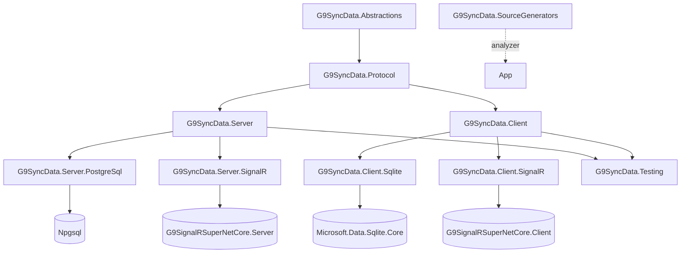
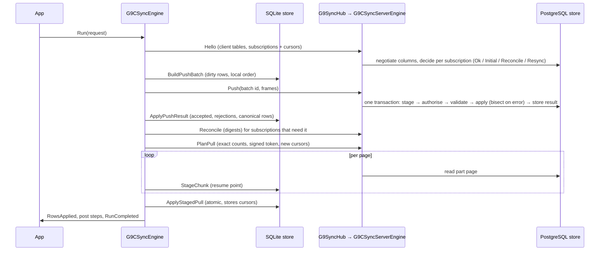

# 02 — Architecture

## Packages and dependencies



| Project | TFM | AOT | Depends on |
|---|---|---|---|
| Abstractions | net10.0 | yes | — |
| Protocol | net10.0 | yes | Abstractions |
| Server | net10.0 | yes | Protocol, M.E.DI/Logging/Options/Hosting abstractions |
| Server.PostgreSql | net10.0 | yes | Server, Npgsql |
| Server.SignalR | net10.0 | yes (hub ctor `RequiresDynamicCode`) | Server, ASP.NET Core, G9SignalRSuperNetCore.Server |
| Client | net10.0 | yes | Protocol |
| Client.Sqlite | net10.0 | yes | Client, Microsoft.Data.Sqlite.Core |
| Client.SignalR | net10.0 | yes | Client, SignalR.Client, G9SignalRSuperNetCore.Client |
| SourceGenerators | netstandard2.0 | n/a (compiler) | Roslyn |
| Testing | net10.0 | yes | Server, Client |

The plan's netstandard2.1 targets for Abstractions/Protocol were dropped (ADR-0004).

## The three contracts

Everything database- or network-specific sits behind one interface, which is what lets another database or transport
be added without touching the engines:

| Contract | Implementations | Owns |
|---|---|---|
| `IG9SyncServerStore` (`src/G9SyncData.Server/Storage`) | `G9CPostgresSyncStore` | capture install, snapshots, reads, push apply, reconcile digests, notifications, tombstone cleanup |
| `IG9SyncClientStore` (`src/G9SyncData.Client/Storage`) | `G9CSqliteSyncStore` | local tables and capture, subscriptions and membership, push batches, staging, apply, digests, reports |
| `IG9SyncTransport` (`src/G9SyncData.Client/Transport`) | `G9CSignalRSyncTransport`, `G9CInMemorySyncTransport` | connect, Hello, Push, PlanPull, Pull, Reconcile, FetchRows, pokes |

The engines (`G9CSyncServerEngine`, `G9CSyncEngine`) hold every protocol rule and never see SQL or sockets.

## A run, end to end



Order matters: push runs **before** pull so the pull sees the device's own accepted edits and never overwrites a
pending one (dirty rows are also protected at apply time).

## Where state lives

| Side | State | Location |
|---|---|---|
| Server | install epoch, table ids, column lists, tombstone horizon | `g9sync.install`, `g9sync.tables` |
| Server | per-row change xid, version, deleted flag, change mask, column versions | one tracking table per synced table in `g9sync` |
| Server | per-client last push batch and its stored result | `g9sync.clients` |
| Server | nothing per session | the server is stateless between calls; pulls resume with a signed token |
| Client | everything else | `g9_*` tables inside the app's SQLite file ([08](08-Client-Sqlite.md)) |

## Adding another database

- **Server:** implement `IG9SyncServerStore`. The hard requirements are an exact, stateless cursor (PostgreSQL uses
  `pg_snapshot`), an atomic push with per-row rejection, and SQL-reproducible digests (or computing them in C#). Put it in
  `G9SyncData.Server.<Provider>` with a `Use<Provider>()` builder extension, and run the integration suite against it
  by making the harness provider-selectable.
- **Client:** implement `IG9SyncClientStore`. Capture must record a monotonic local sequence and a dirty column mask
  without library writes being captured.
- Record the decision in [10-Decisions.md](10-Decisions.md).

## Observability (ADR-0019)

| Side | Source / meter | Instruments and activities |
|---|---|---|
| Client | `G9SyncData.Client` (`G9CSyncClientTelemetry`) | counters `g9sync.client.runs` (outcome, priority), `g9sync.client.rows.pushed`, `…rows.downloaded`, `…rows.applied`, `g9sync.client.rejections`, `g9sync.client.conflicts`; histogram `g9sync.client.run.duration` (ms); activity `G9Sync.Run` (run id, priority, outcome, counts, error code) |
| Server | `G9SyncData.Server` (`G9CSyncServerTelemetry`) | counters `g9sync.server.hellos`, `…pull.plans`, `…pull.planned_rows`, `…pull.rows`, `…pushes` (already_applied), `…push.rows` (result), `…reconciles`, `…reconcile.mismatched_buckets`; histogram `g9sync.server.push.duration` (ms); activities `G9Sync.PlanPull`, `G9Sync.Push` |

```csharp
builder.Services.AddOpenTelemetry()
    .WithTracing(t => t.AddSource(G9CSyncServerTelemetry.Name).AddSource("Microsoft.AspNetCore.SignalR.Server"))
    .WithMetrics(m => m.AddMeter(G9CSyncServerTelemetry.Name));
```

Structured logs (`[LoggerMessage]`, event id ranges in [01](01-Project-Rules.md)) and the client's persisted run reports
(`GetHealthAsync().RecentRuns`, with per-phase milliseconds) complete the picture.

## Server-side change feed (ADR-0018, plan D-15)

Server code that must follow a synced table — a map cache, a search index, a projection — reads the same exact change
stream devices get, without subscriptions and without touching capture internals:

```csharp
var feed = services.GetRequiredService<IG9SyncServerChangeFeed>();   // registered by AddG9SyncDataServer
var cursor = await store.LoadCursorAsync() ?? await feed.GetCurrentCursorAsync();   // first run: rebuild from the table, then follow
while (true)
{
    var page = await feed.ReadAsync("Operation.Pot", cursor, limit: 1000);
    foreach (var change in page.Changes) Apply(change);   // Key, Version, Deleted, ChangedColumns, OriginClient, ChangedAtUtc
    cursor = page.NextCursor;
    await store.SaveCursorAsync(cursor);                  // only after the page was processed
    if (!page.HasMore) break;
}
```

Cursors are stateless strings; store one per consumer and table. `G9S-RSY-HORIZON` or `G9S-RSY-EPOCH` means rebuild from
the table and start again from `GetCurrentCursorAsync()`. The notifier (`G9CSyncChangeNotifier.TablesChanged`) says when
to read.
