# G9SyncData and G9SignalRSuperNetCore: deep review for AgriPad

Review date: 2026-09-17. This is an assessment and implementation proposal, not an implementation change.

**Recommendation: continue investing in these libraries, but keep G9SyncData in the shadow/pilot stage until the correctness and integration blockers below are resolved.** The architecture has useful foundations and measurable optimization work. Its largest remaining opportunities are safe recovery, application consistency, bounded resource use, and the path from a committed sync batch to a visible map update. Adding more transport features alone will not solve those problems.

I reviewed both libraries together, as requested:

- `Agriculture.AgriPad/G9SyncData`, commit `a7645eb`.
- `Agriculture.AgriPad/tmp/G9SignalRSuperNetCore`, commit `2ce660f`, release 2.6.0.
- The current AgriPad and Mobile server integration, including the uncommitted dynamic-attribute pilot, against [G9SyncData.md](G9SyncData.md), [G9SyncData-V2.md](G9SyncData-V2.md), and the AgriPad guides.

The application working tree already contained changes. They were preserved. Only this report is added to the agriculture repository by this review. Reproduction tests were created outside the repository and ran against a newly created, isolated PostgreSQL instance.

## How to use this report

Start with the decision table, then read findings relevant to the next migration slice. The progressive map proposal is in [section 5](#5-progressive-pot-and-tree-sync-that-can-actually-update-the-map). The [validation plan](#7-validation-and-performance-gates) and [reproduction appendix](#9-reproduction-recipes) give another agent concrete ways to challenge the conclusions.

Evidence labels:

- **Reproduced:** an executable counterexample against the reviewed code.
- **Source-confirmed:** directly visible in implementation; the described field failure was not reproduced on a device.
- **Proposal:** a new capability or contract, not a claim that existing documented behavior is defective.
- **Investigate:** plausible risk requiring a focused experiment before changing code.

Priority means **relative to the proposed production cutover**: P0 blocks the affected cutover; P1 is high-value work before broad rollout; P2 is conditional or later. The current shadow pilot does not mean these defects have already affected live AgriPad users.

## 1. Decision table

| ID | Finding / opportunity | Evidence | Priority and practical decision |
|---|---|---|---|
| F01 | Old staged pulls can overwrite acknowledged edits and restore revoked rows | Reproduced, two scenarios | P0: fix before bidirectional or permission-sensitive cutover |
| F02 | Push replay receipts are selected by client ID without binding that ID to the authenticated principal | Reproduced | P0: fix before exposing this as a production sync endpoint |
| F03 | A newly forbidden subscription is failed, but its existing membership is not disposed through revocation policy | Reproduced under default policy | P0 for permission-sensitive cutover; map explicitly to AgriPad's retain-but-hide policy |
| F04 | Post-commit effects can be lost permanently after a successful push | Reproduced | P0 for workflow/effect-dependent tables; add durable delivery |
| F05 | `TRUNCATE` is invisible to ordinary synchronization in both capture modes | Reproduced | P1; either support invalidation or make prohibition explicit and enforceable |
| F06 | EF writes do not automatically execute application-service business rules | Source-confirmed | P0 for domain operations; audit invariants before enabling uploads |
| F07 | The local change feed is not yet a complete durable projection contract | Source-confirmed | P0 before removing Dotmim tracking from map source tables |
| F08 | Streaming transport still permits large memory, disk, and transaction accumulation | Source-confirmed | P1; budget resources end to end, not just item counts |
| F09 | Scope membership and reconciliation are less automatic and less difference-proportional than the V2 vision | Source-confirmed | P1; define freshness and dependency invalidation |
| F10 | Commands, ordinary rows, and aggregate changes lack one general ordering/atomicity contract | Source-confirmed / proposal | P1; support explicit business operation boundaries |
| F11 | Scheduling needs a visibility objective, recovery mode, and fairness | Source-confirmed / proposal | P1 for progressive and interactive use |
| F12 | Backup restore and identity/receipt generations need an explicit protocol | Source-confirmed / investigate | P1 before relying on device restore/clone scenarios |
| F13 | Schema evolution and offline retention need product-level compatibility contracts | Source-confirmed / proposal | P1 for mixed-version rollout |
| F14 | WAL capture needs large-transaction and operational validation | Source-confirmed / investigate | P1 before making WAL the default deployment mode |
| F15 | Multiple server instances need deployment invariants beyond signed pull tokens | Source-confirmed / proposal | P1 when scaling out |
| T01 | The resilient stream helper does not own producer lifetime | Source-confirmed | P1 for users of that helper; G9SyncData does not currently use it |
| T02 | Singleton rate-limit buckets accumulate by disconnected connection ID | Source-confirmed | P1 for long-running hosts using rate-limit attributes |
| T03 | Generated no-result `Task` methods use send semantics | Source-confirmed | P2 API contract correction; current G9SyncData handwritten proxy is separate |
| T04 | Pokes, reconnect, auth freshness, and stream telemetry need stronger lifecycle handling | Source-confirmed / proposal | P1 for reliable low-latency updates |
| T05 | Optional file upload treats a matching filename as a completed upload | Source-confirmed | P1 before adopting it for attachments; current AgriPad blob pipeline is separate |

### What is already worth keeping

This is substantially more than an empty wrapper around SignalR. Useful implemented pieces include typed protocol errors, per-row rejection isolation, column negotiation/backfill, server-side scope queries, overlapping subscription membership, a durable client command outbox, reconciliation, staged pull resume, priorities, binary frames, MessagePack support, EF and raw database write paths, and a fault-injection harness.

The SQLite work is particularly relevant: raw SQLitePCL bindings, prepared statements, avoiding per-value allocations, sorted loads, controlled trigger suppression, and index rebuilding for initial loads address real costs. Do not discard that work to replace it with a general ORM on the mobile hot path. Likewise, keep the transport seam and source-generated client serialization.

The [library performance guide][performance] reports substantial gains, including lower allocation and faster large initial applies. Those are useful measurements, **not independently remeasured performance results from this review**. Many measurements are desktop, emulator, loopback, synthetic pots, or matching-row reconciliation. They do not establish performance for a physical AgriPad device simultaneously syncing, editing SQLite, projecting the geodatabase, and rendering the map.

### Important differences between the V2 vision and current behavior

| V2 intention / likely expectation | Current implementation | Consequence |
|---|---|---|
| Membership reconciliation becomes central to synchronization | The engine reconciles on selected conditions, explicit requests, or configured intervals | Query-dependent move-ins/move-outs still need a freshness policy |
| Repair cost is proportional to the difference | Digests can require full membership scans; mismatched buckets list many unchanged keys | Small wire digests do not imply small CPU, memory, or query cost |
| Stream records and display them progressively | Pull chunks are staged, then applied as a complete pull | Transport streaming does not yet deliver progressive application visibility |
| Writing through EF runs normal application behavior | `SaveChangesAsync` runs EF hooks; application-service methods are not called automatically | Domain validation, authorization, and side effects need explicit integration |
| Stateless resume across servers | Signed tokens support it if signing keys, model, database epoch, and auth interpretation agree | Deployment configuration remains part of correctness |
| Flexible general library | Single-column keys, 62 physical columns, 63 persistent subscriptions, SQLite file/provider constraints | These limits should be explicit adoption checks, not surprises during migration |

## 2. AgriPad contracts the replacement must preserve

The replacement is not only a faster way to move Pot rows. These existing contracts influence the design.

| Project behavior | Replacement requirement |
|---|---|
| `INITIAL_V2` and reference scopes prepare site roots and shared lookup data | Readiness and dependency completion must be explicit; “some rows exist” is insufficient |
| `FARM_V4` carries pots, trees, placements, graft-related data, and dynamic attributes | Preserve shared-row ownership and the relationships needed to render and edit a pot |
| `GREENHOUSE_V3` shares tree/placement data, but greenhouse pots are derived from line/row geometry | Support application projections and dependency fan-out; a Pot-only streaming API is insufficient |
| Sampling and transfer detail are provisioned on demand | Preserve first-success/offline readiness gates, dependent reference data, and per-task subscription cleanup |
| `TASK_V0` is a bounded, assignee-filtered list | List eviction must remove membership without pretending the underlying Task was deleted |
| User/person and farm/greenhouse scopes overlap | Releasing one subscription must preserve rows still held by another |
| State transition history triggers business processing after sync | Commit of the history row and durable scheduling of its processing must not diverge |
| Observation sync fills geometry and handles delete cleanup | Port the behavior explicitly, including comments/attachments; generic CRUD does not replace it |
| Attribute values can be superseded with related option rows | Preserve operation-level validation and consistency, including datatype/applicability rules |
| SQLite is the editable replica; ArcGIS geodatabase is a separate flattened projection | Have independent durable projection checkpoints and gap recovery |
| Permission repair currently retains revoked site data but hides it | Do not silently replace that decision with destructive purge; preserve unsent work and query visibility rules |
| User logout/impersonation switches partitions and disposes session resources | Cancel runs, invalidate queued callbacks, and bind staged work/feeds to the correct partition generation |
| Couchbase attachments use a separate pipeline | Coordinate row readiness and blob availability without turning row frames into photo/video containers |
| Server-side attribute tracking also serves web cache behavior | Retiring Dotmim capture requires an inventory of non-mobile consumers, not only mobile scopes |

These contracts come from the [original inventory](G9SyncData.md), [AgriPad guide index][app-guides], [permission repair guide][permissions], [dynamic attribute guide][attributes], [map performance guide][map-performance], [map component guide][map-guide], and the current source. Some historical guide examples use older scope versions; the migration manifest should be generated/verified against the registrations actually deployed.

The current [G9 pilot guide][pilot-guide] describes a separate shadow database for dynamic attributes. That is a useful validation seam. It is not a complete replacement of the existing app sync path or its authentication, audit, map, and attachment behavior.

## 3. Correctness and integration findings

### F01 — Resuming a completed old stage can undo newer work

**Reproduced. P0.** See [client execution][execution], especially lines 79–151 and `DownloadAsync`, and [SQLite apply][apply].

The next run performs Hello, pushes local changes, and may reconcile permissions. It then accepts an existing staged pull primarily because its age is below `StagedPullMaxAge` (default 90 minutes). A stage already marked complete returns from `DownloadAsync` without asking the server to validate its token. The subsequent apply upserts its old rows and restores its old cursors/hashes.

Two counterexamples passed through a run reported as successful:

1. Download server `Status = 1` into a complete stage, but do not apply it. Change the local value to `2`. In the next run, the server accepts `2` under ClientWins; applying the old stage then changes the local value back to `1`. The server remains `2`.
2. Stage an authorized row, then remove the caller's allowed site. The next run reconciles and moves the row out, then the old stage puts it back. The trace explicitly shows “moved out 1” followed by resume and apply.

This is more than a stale progress report. It violates acknowledged-edit and permission-change guarantees. The probes simulate interruption at a storage seam after the final chunk, rather than killing an Android process.

**Recommended change:** make a staged pull belong to a validated generation: client/partition identity, server epoch, negotiated model/column shape, subscription set and parameters, auth/definition versions, and the local/server state against which it was planned. Revalidate even a fully downloaded stage. If a new push or reconciliation invalidates that generation, discard/replan, or use a formally defined merge that cannot roll state backward. Add an independent stale-version guard within an epoch where the store's version semantics support it; a numeric comparison alone must not be the whole solution.

**Acceptance:** the two probes converge correctly; repeat with schema changes, subscription removal, a different requested scope, server epoch change, and a partially completed stage. A canceled large site download must not hijack a new urgent site request.

### F02 — Cached push results are not bound to the authenticated principal

**Reproduced. P0.** See [PostgreSQL push][pg-push], lines 38–62, and `TouchClientAsync` in [the PostgreSQL store][pg-store].

The push transaction selects `last_push_batch` and `last_push_result` using a request-supplied `client_id`. A matching batch returns the stored result before row authorization. The database record contains `user_id`, but this replay path does not compare it with the current caller. Hello's touch operation can also update the stored user for a client ID.

The probe created a conflict as Alice, producing a cached canonical row. Bob then submitted Alice's client ID and batch ID with an empty stream. The engine returned **one canonical frame from Alice's result** instead of rejecting the identity mismatch.

This test crosses authenticated principals at the engine layer. It requires knowing the other client's identifier and batch number; it is not a demonstration of anonymous access through the real Mobile deployment. A random GUID should still not function as the authorization boundary.

**Recommended change:** register/bind each device incarnation to authenticated tenant/user identity and reject reassignment. Include a canonical request fingerprint in receipt identity so reuse of an ID with different content is detectable. Decide how replay behaves after the same user's permissions change: preserve the idempotent outcome while withholding or freshly authorizing canonical data that is no longer readable. Add tests for different users, tenant boundaries where applicable, changed permissions, changed payload, and concurrent device clones.

### F03 — Forbidden subscription is not a complete revocation transition

**Reproduced under the default deletion policy. P0 for the affected migration.** See [client execution][execution], lines 92–103, and the [SQLite revocation implementation][revocation].

When Hello returns `Forbidden`, the engine marks that subscription failed and excludes it from the usable list. It does not route its already-held rows through subscription release/revocation processing. In the probe, three previously downloaded pots remained after the subscription became forbidden. This is separate from the implemented path where a still-valid subscription reconciles to a smaller authorized row set.

For a general library, “cannot refresh this subscription” needs a precise distinction from “the principal is no longer allowed to use these rows.” A transient network/auth refresh problem also must not be treated as definitive revocation.

**Recommended change:** expose a terminal authorization transition that runs the configured retain/mark/quarantine/delete policy and updates visibility atomically. Preserve membership held by another authorized subscription and preserve recoverable local work. Make the reason available to the application without requiring it to infer semantics from an error string.

**AgriPad-specific decision:** [guide 20][permissions] retains revoked site data and hides it. The desired fix is not “delete all three pots in production.” The probe demonstrates that the default library disposition path is skipped; AgriPad should configure retain-and-hide behavior and enforce that in every normal read, task gate, and map layer. Test offline revoke/regrant, overlapping scopes, pending edits, and export/diagnostic access.

### F04 — Successful push does not durably deliver post-commit work

**Reproduced. P0 for workflow/effect-dependent tables.** See [server engine][server-engine], lines 400–402 and 679–716, and the transaction commit in [PostgreSQL push][pg-push].

The row transaction and its replay receipt commit first. Post-commit handlers then run in-process; exceptions are logged and swallowed. An already-applied push skips the handlers entirely.

The probe used a handler that fails only on its first call. The row committed, the client run succeeded, and replay returned `AlreadyApplied`, but the effect was never retried. A process crash after commit and before the handler has the same lost-work window. Removing cancellation from a callback does not close that window.

This matters for state transition processing, cache invalidation, attachment cleanup jobs, and derived projections. The existing Dotmim integration also has post-commit behavior; inheriting its weak delivery semantics would miss an opportunity to improve reliability.

**Recommended change:** store an effect/outbox record in the same database transaction as the accepted operation. A worker dispatches it with retry, idempotency keys, attempt history, and a visible terminal-failure state. Keep an optional best-effort callback for metrics or UI hints, but name/document it accordingly. Do not promise exactly-once external effects: use durable at-least-once delivery plus idempotent consumers. Essential database invariants should remain inside the transaction where feasible.

### F05 — `TRUNCATE` leaves stale replica rows

**Reproduced in trigger and WAL modes. P1; conditional on allowed database operations.** See [capture SQL][capture-sql] and [logical replication source][logical-source].

Statement capture installs INSERT/UPDATE/DELETE triggers. The logical decoder handles insert, update, and delete messages but has no truncate case. After downloading three pots, `TRUNCATE farm."Pot"` on the test server followed by ordinary synchronization produced zero downloaded rows and left all three on the client in both modes.

**Recommended change:** choose an explicit contract. Either support table invalidation/generation change, forcing authorized reconciliation or re-seeding, or prohibit truncate on captured tables through operational policy and database permissions. Supporting one efficient invalidation marker is preferable to manufacturing millions of individual tombstones. Invalidate digest/key-set caches too. Add tests for truncate with cascade, rollback, and a client holding unsent rows. Do not assume manual repair or an unspecified future reconciliation interval makes this operation correct.

### F06 — EF persistence is not domain-operation execution

**Source-confirmed. P0 for affected uploads.** See [EF row writer][ef-writer], [EntityAttributeValueService][attribute-service], and [existing sync callbacks][sync-controller].

The EF row writer loads entities, assigns authorized columns, and calls `SaveChangesAsync`. This correctly enables EF interceptors, audit stamping, and SaveChanges overrides. It does **not** call service-layer methods such as attribute applicability checks, option/datatype validation, or a workflow operation merely because the entity type matches.

The current pilot is also intentionally based on site select permission for visibility and ignores EF query filters in scope queries. That is documented, not a hidden implementation mistake. Before enabling uploads, independently establish write permission, workflow/state permission, and ownership of parent/child rows. “Can see this site” is not itself a complete write-authorization design.

**Recommended change:** build an invariant matrix per migrated operation: authorization, validation, transformations, related writes/deletes, audit, and durable effects. Keep simple independent edits on the row path with explicit validators. Use named command handlers that invoke the application's domain logic for operations such as move tree, supersede attribute value/options, or perform workflow transition. Refactor shared validation into reusable services if necessary; do not duplicate a second weaker set inside the sync library.

Preserve set-based validation and bounded EF batches. Calling an application service separately for every one of 100,000 rows would recover behavior at an unacceptable cost. Tests must assert domain outcomes and rejection isolation, not only matching row counts.

### F07 — The change feed needs a durable projection contract before map cutover

**Source-confirmed. P0 before retiring map-source tracking.** See [SQLite query/feed][sqlite-query], [GeoSyncCoordinator][geo-coordinator], and [GeoSyncDataService][geo-data].

The new local feed returns sequence, key, deletion, and pending state from the current `g9_rows` metadata. This is a useful coalesced invalidation feed, but it is not an immutable history of all changes. Deleted metadata can be purged without a registered consumer checkpoint or an explicit “your cursor fell behind retention” response. `RowsApplied` also caps reported changed keys (default 5,000), so it cannot be the only source for a large projection update.

The current map code depends directly on Dotmim tracking timestamps across Pot, Tree, Placement, and Graft. It has per-farm watermarks, bounded work, and reverse lookup from the geodatabase for deleted placements. Removing tracking tables before replacing those consumers breaks a second pipeline even if SQLite replication is correct.

**Recommended change:** provide a generic committed-change interface with feed epoch, sequence range, low retention watermark, consumer acknowledgment, and a gap/reset response. Keep notification events as wake-up hints; the durable feed is authoritative. A projection should acknowledge only after its destination commit succeeds. Since SQLite and the ArcGIS geodatabase do not share a transaction, use idempotent replay, not a fictitious cross-store atomic commit.

For relationship changes, preserve enough information to invalidate both the old and new affected pot. That can be an application reverse index/old projected fields or selected before/after dependency keys; it need not be complete historical row copies in the generic library. Preserve the existing deletion reverse lookup. A placement move, graft change, or greenhouse geometry change can affect multiple rendered features even when the changed table is not Pot.

**Acceptance:** kill after SQLite commit but before geodatabase commit; kill after geodatabase commit but before feed acknowledgment; allow a consumer to fall behind tombstone retention; move/delete a placement; change a graft; rebuild a greenhouse row. Each must converge without replaying unrelated farms or silently skipping features.

## 4. Performance, consistency, and flexibility findings

### F08 — Bound bytes and work through the entire pipeline

**Source-confirmed. P1.** See [server push collection][server-engine], [row reader][row-reader], [client reconciliation][reconcile], [SQLite apply][apply], and [server reconciliation][pg-reconcile].

There are existing limits; the problem is that they do not form a small end-to-end resource budget:

- Server push collects compressed frames into a list before resolving the sync auth context; the default total is 128 MiB. Authentication on the hub endpoint is still a separate earlier protection.
- Row-frame readers accept a body size up to the format limit plus layout allowance: 512 MiB + 64 MiB. A highly compressible frame can therefore be much larger after decoding than its network size suggests.
- Client reconciliation accumulates server-key dictionaries, local lookup dictionaries, requested/returned key sets, and fetched frames. A large mismatch can approach the size of the subscription in memory.
- Pull staging writes the compressed download to disk before applying it into base tables and metadata. This buys recovery/atomicity, but creates disk amplification and a potentially long SQLite write transaction.
- Server reconciliation retains a repeatable-read transaction while yielding its results. Slow consumers can extend connection and snapshot lifetime.
- Row limits do not account well for highly variable JSON/geometry values. Command count, command JSON, compressed bytes, decoded bytes, affected rows, and canonical-result bytes need compatible budgets.

**Recommended change:** introduce explicit limits for compressed frame size, decoded frame size, aggregate decoded push work, command payload/result size, rows per atomic unit, staged bytes, transaction duration, and concurrent active streams. Enforce critical limits at ingress before large allocation, then inside decode/apply. Use bounded disk staging or paged merge for large reconciliation, rather than retaining every fetched frame in memory.

Page by both rows and a target byte budget, with special handling for a single oversized row. Tune compression from measured CPU-versus-network tradeoffs; already-compressed blobs should not be repeatedly compressed. Prefer a bounded channel with waiting for durable data. Dropping items is acceptable only for replaceable notifications, never for replica mutations.

SignalR's default upload buffer is an item count, and its per-client parallel invocation limit excludes streaming invocations. The library configures a 16 MiB per-message receive limit, overriding the framework's smaller default; neither setting bounds an entire sync. Add application admission control rather than relying on those settings alone. [Microsoft SignalR configuration](https://learn.microsoft.com/en-us/aspnet/core/signalr/configuration?view=aspnetcore-10.0).

Measure SQLite busy-wait time, application write latency, and WAL size during sync. `journal_size_limit` is not a hard cap on active WAL growth. Long-lived readers can prevent checkpoint completion, and SQLite still permits only one writer at a time in WAL mode. [SQLite WAL documentation](https://www.sqlite.org/wal.html).

### F09 — Make membership freshness explicit; benchmark mismatches, not only equality

**Source-confirmed. P1.** See [client reconciliation][reconcile], [digest implementation][digest], [digest cache][digest-cache], [engine reconcile scheduling][execution], and [known limitations][limitations].

A scope query can change because a related table changed, even when the selected row did not: moving a Ridge to another Block, changing a tree's current Placement, changing assignment, or changing authorization/state. Base-row deltas alone cannot fully describe membership changes. Current reconciliation repairs them, but when that repair runs matters. A compiled EF query is not an automatically maintained reactive dependency graph.

The current digest has 256 buckets. With 500,000 uniformly distributed keys, one bucket contains roughly 1,953 keys. If 1% of rows change randomly, nearly every bucket differs. The payload of actual changed rows may be small, while the reconciliation key listing approaches the whole table. The expected number of touched buckets is `B * (1 - (1 - 1/B)^m)` for `m` independently distributed changes. Increasing to 4,096 buckets helps some workloads, but is not equivalent to work proportional to changed rows.

The client computes membership digests by scanning metadata. Server caching helps repeated comparisons, but cold/invalidated cases and dependency tracking still cost work. Hashes cover key/version and computed columns; they do not compare every physical value, so out-of-capture local corruption with unchanged version can remain invisible. These are documented boundaries, not newly invented bugs.

**Recommended change:** define a freshness policy per subscription: immediate dependency invalidation for important authorization/assignment changes, scheduled bounded reconciliation for ordinary membership churn, and occasional integrity audits where warranted. Allow explicit dependency declarations when query introspection cannot discover tables behind functions or external authorization state. Ensure auth/definition versions cover everything relevant to visibility.

Only after measurement, consider a deeper bucket tree, persisted client bucket summaries updated in the same transaction, server delta/CVR caching, or indexed key/version diff. Compare the cost of maintaining each structure against its saved scans. Also provide a deliberate content-verification/repair mode; `MarkDirtyAsync` is useful for intentional out-of-band edits but is not an audit of unknown corruption.

### F10 — Offer explicit operation boundaries for commands and rows

**Source-confirmed / proposal. P1.** See [push ordering][pg-push], [client command outbox][commands], and [known limitations][limitations].

The client has separate ordering for ordinary dirty rows and commands. The server executes commands first, then row changes in model table order. This supports rows depending on an earlier command, but does not establish a general causal order for a command that depends on an ordinary row created just before it. Sorting commands by their own sequence does not unify both streams.

Per-row bisection is valuable for unrelated edits, but splitting an aggregate can be wrong: retiring an attribute value without inserting its replacement/options, or accepting half of a tree-move operation, may be an invalid business result even when every individual SQL statement is legal. A table order also cannot express every parent/child and delete dependency.

**Recommended change:** keep two explicit modes: independent row synchronization and atomic named business operations. For mixed work, provide a bounded operation group or dependency/barrier mechanism with clear receipt semantics. Start with a few operations actually needed by AgriPad; a general arbitrary dependency-graph scheduler is not the first implementation step.

Commands currently use protect-and-settle optimistic behavior, not automatic rebase. Preserve that honest contract. Define how two pending commands touch the same row, how a rejected predecessor affects successors, how command schema versions remain compatible with old clients, and how the UI exposes a settlement failure. Test multi-device conflicting moves and supersedes, not only an isolated command succeeding.

### F11 — Schedule for visible usefulness and preserve a download recovery path

**Source-confirmed / proposal. P1.** Existing priorities and cancellation are useful, but the run still has long phases and one staged pull. F01 also means a stale stage can defeat the intent of a newly selected request.

Prioritize a useful, internally consistent unit: site roots, then the visible block's map data, then the rest of the pinned site, then background detail. A 100,000-row table ordered by GUID has good storage behavior but little relationship to what the user is looking at. Do not trade that locality away casually; spatial/block scheduling can select units while keeping key order inside each unit.

Give background subscriptions an aging/fairness rule so frequent viewport changes do not starve them forever. Add explicit reasons/deadlines to requests, collapse duplicate requests, and invalidate work when the partition/site generation changes. Checkpoint at bounded safe boundaries so canceling an offscreen task is prompt without losing already durable units.

There is also a recovery concern: [PostgreSQL push][pg-push] throws once rejections exceed the configured maximum (default 50). Because a normal run pushes before pulling, a large invalid upload batch can fail the run before useful downloads. The library can request pull-only work, but the app needs a deliberate policy to use it. Preserve terminal upload errors, split/quarantine bounded invalid work, and allow safe download-only recovery where domain dependencies permit. Do not turn every failure into infinite retry or silently discard rejected edits.

### F12 — Define device restore, clone, and receipt generations

**Source-confirmed risk; restore outcome needs a dedicated test. P1.** The client persists its identity and batch sequence in SQLite. The server stores the last batch/result; older batch IDs return `AlreadyApplied`, with an empty result when not equal to the latest batch. See [PostgreSQL push][pg-push] and [SQLite push][sqlite-push].

Restoring an old device database can reuse the same client ID and lower batch numbers. Copying a partition to two devices can create divergent writers sharing an idempotency namespace. A retry with the same number is only safely identical if its content really is the original operation. Server database restore can create the inverse mismatch.

**Recommended change:** negotiate a replica incarnation and server epoch; maintain stable mutation IDs/fingerprints across retries, but detect a restore or fork that reuses the namespace. Define receipt retention and an explicit “outcome unknown / reconcile before replay” recovery path. Preserve unsent commands across recovery; never solve identity ambiguity by silently wiping a partition.

Test backup-before-push, restore-after-ack, two cloned devices, restore of the server, and server receipt retention expiry. F02's principal binding should be designed together with this protocol, not as an unrelated security patch.

### F13 — Schema and retention flexibility should be explicit, bounded contracts

**Source-confirmed / proposal. P1 for rollout; some capabilities P2.** See [SQLite guide][sqlite-guide], [known limitations][limitations], and [AgriPad migration guidance][client-migrations].

Negotiated columns and backfill already solve useful additive evolution. They do not automatically solve renames, type/converter changes, enum meaning changes, removed columns with unsent values, key changes, or changed JSON command payload semantics. Pending masks can be widened when model order changes, but the business meaning of old offline data still needs an upgrade policy.

Create a schema compatibility manifest and migration hooks with explicit minimum readable/writable versions. Separate physical table migration, sync metadata migration, command payload upcasting, and projection rebuild. Refuse incompatible upload with a recoverable explanation while retaining data. Test N/N-1 devices against N/N+1 servers, including a device offline across multiple releases.

For membership, 63 persistent subscriptions can be a real limit once users pin sites and task details. Ephemeral subscriptions already provide an escape hatch; measure and document how callers should use them. If sustained needs exceed this, consider a join-table representation or compact alternative, with a benchmark against the current mask. Likewise, add composite keys, more than 62 columns, BLOB GUID storage, or SQLCipher only for demonstrated consumers; each changes hot-path assumptions.

Offline retention should distinguish user-pinned data, recently viewed caches, shared reference rows, pending/rejected work, quarantined rows, and derived map data. Add disk-budget diagnostics and policy hooks. TTL expiry must not unexpectedly destroy useful unsent work or remove data still held by another scope. AgriPad's partition and permission rules remain authoritative.

### F14 — WAL capture needs bounded transaction handling and operational proof

**Source-confirmed / investigate. P1 for WAL deployment.** See [logical replication source][logical-source], [WAL capture service][wal-service], [capture SQL][capture-sql], and the [infrastructure guide][infrastructure].

WAL mode removes much of the ordinary writer-side capture work, but it still maintains tracking state and guarded triggers for sync-origin pushes. It is not zero-cost capture and does not eliminate database objects. The decoder accumulates a transaction's changed rows in a list and dictionary, then copies them to an array on commit. A very large office import can therefore cause memory pressure independently of the page size used for client downloads.

Validate large transactions, capture catch-up, cancellation, and slot recovery before selecting defaults. Introduce spill-to-disk or bounded transaction processing if real imports exceed the budget. Preserve commit-order and durable acknowledgment guarantees. Primary-key updates need an explicit immutable-key contract or old-key removal handling; reading only the new update row is insufficient as a general mutable-key design.

Two focused operational experiments remain worthwhile:

1. **Idle replicated tables with busy unrelated tables:** empty transactions are not yielded, and sync-point batches carry a start position. Verify that confirmed LSN still advances sufficiently when there are no nonempty captured transactions. This is a retention hypothesis, not a measured leak in this review.
2. **Tracking lag versus current row reads:** the documented WAL/key-set path can read new base values before corresponding tracking catches up. Establish the promised freshness/consistency semantics under concurrent moves and permission changes; do not describe it as an exact historical row snapshot.

Monitor capture lag, retained WAL bytes, slot state, longest transaction, retry rate, rescan duration, and catch-up time after restart. Replication slots retain required WAL/catalog resources and survive connections, so an abandoned slot is an operational resource, not just a disconnected stream. [PostgreSQL logical decoding concepts](https://www.postgresql.org/docs/current/logicaldecoding-explanation.html).

### F15 — Scale-out depends on shared deployment invariants

**Source-confirmed / proposal. P1 when deploying multiple nodes.** See [token service][tokens], [digest cache][digest-cache], and [capture infrastructure][infrastructure].

The token service creates a random process key if no valid key is supplied; it also silently replaces a supplied key shorter than 32 bytes. Different nodes or a restart will then reject one another's pull tokens. Documenting a shared key is helpful, but production startup should fail on an invalid configured key. Support key identifiers and a bounded old-key verification window for rotation if long pulls must survive deployment.

Also test a mixed-version rolling deployment: model/column IDs, scope definitions, database epoch, capture installation/publication membership, and authorization semantics must agree. Avoid each node independently changing shared capture objects while other versions still serve clients. Have an explicit installation/migration owner and readiness health check.

Keep digest caches and rate limits clearly labeled as process-local or shared. Decide how poke notifications cross nodes, and test real routing/reconnect with the chosen backplane/load balancer. A unit test swapping in-memory engines cannot prove these deployment properties. Add per-principal/global active-stream budgets and database pool headroom for the rest of the application; increasing connection pools is not a substitute for limiting admitted work.

## 5. Progressive pot and tree sync that can actually update the map

**Yes, this is practical. The best next step is a small progressive pilot with an explicit consistency unit, backed by a durable projection feed.** It does not require replacing ArcGIS or turning every row into a managed graphic.

### 5.1 Separate four kinds of progress

The UI should distinguish data received, data committed to SQLite, data projected into the geodatabase, and data ready for interaction. A download percentage reaching 100% says nothing about the last two.

Current flow:

```text
Plan whole pull -> stream chunks into SQLite staging
                -> apply whole staged pull -> notify
                -> app projects changes into ArcGIS geodatabase -> visible map
```

Proposed optional flow:

```mermaid
flowchart LR
    A[Authorized unit plan] --> B[Bounded chunk download]
    B --> C[Validate complete unit]
    C --> D[SQLite transaction]
    D --> E[Durable committed change feed]
    E --> F[Bounded app projection batch]
    F --> G[Geodatabase commit]
    G --> H[Advance projection checkpoint]
    H --> I[Refresh affected features]
    I --> J[First useful map content]
```



A unit could be a bounded group of pots plus the placements/trees required for their chosen display contract, inside one block. The generic library owns unit identity, ordered delivery, validation, application, and resume. AgriPad owns “what makes these features useful,” geometry derivation, and ArcGIS projection.

### 5.2 Choose consistency deliberately

| Mode | Good use | Cost / limitation |
|---|---|---|
| Existing atomic pull | Small references, dependent detail, simplest recovery | First visibility waits for the entire pull |
| Atomic group within a pull | Progressive block/map loading with bounded related data | Needs server/client unit boundaries, per-unit receipts/checkpoints, and partial readiness |
| Independent row/table visibility | Truly independent lookup rows or a consciously incomplete preview | Relationships may temporarily be absent; users must not act on incomplete data |
| Separate preview projection | Very fast read-only map preview before editable data finishes | Extra storage/protocol and freshness semantics; avoid making it a second editable authority |

For the first implementation, prefer **atomic groups** for one farm map use case, while preserving the existing atomic mode. Merely calling `ApplyChunk` for every frame can expose Tree before Placement, or retire one entity before its replacement arrives. Conversely, insisting on a full site transaction prevents the experience the user wants.

A limited first pilot could display pot locations with a neutral “details loading” appearance, then enrich them with tree/graft styling when the related unit is complete. Editing and task execution must use readiness gates, not the presence of a marker. Decide whether older complete data stays usable while a new generation is downloading; usually that is better than blanking the map.

### 5.3 Define unit and cursor semantics before API names

The contract needs:

1. A plan/generation ID bound to partition, model, subscription parameters, authorization, and server epoch.
2. Stable unit IDs, ordering/dependencies, and an end-of-unit marker. For resumed units, enforce completeness and reject duplicate/conflicting content.
3. Atomic commit of a unit's rows, membership changes, and its durable local checkpoint. Advance the subscription's final cursor only when its required units are complete, unless a new protocol explicitly supports partial cursors.
4. Idempotent replay after a disconnect or process death. A received frame is not yet an applied frame, and an applied frame is not yet a projected feature.
5. A finalization rule for removals: an unvisited part of a partial snapshot must not be interpreted as deleted. Mark-and-sweep, if used, only sweeps after the relevant authorized generation is complete.
6. Explicit readiness: `Absent`, `Loading`, `PartiallyVisible`, `ReadyForOperation`, `Stale`, `Revoked`, and failure information can be mapped into an app-facing model. The actual public API can be simpler, but these states must not collapse into one boolean.
7. Safe cancellation/supersession when the viewport, site, user, or app lifecycle changes. Completed authorized units may remain cached under retention policy; stale callbacks cannot update the new user's map.

Do not promise a globally exact historical snapshot unless the server can actually provide it. A progressive view can use a documented “consistent unit, eventually current subscription” contract, followed by deltas, provided permissions and business operations remain correct.

### 5.4 Use the existing map architecture

The [map performance guide][map-performance] records 142,214 pots at approximately 1,016 MB PSS, including 629 MB native memory, on its measured emulator scenario. Steady-state rendering was healthy; cold materialization and refresh were much more expensive. Those historical measurements are not new results from this review.

Keep `FeatureLayer` over `GeodatabaseFeatureTable`. The guide already investigated and rejected replacing the dataset with a `Dictionary<string, Graphic>`/GraphicsOverlay approach at this scale. Streaming must not recreate hundreds of thousands of managed objects on every progress callback.

Build on the current coordinator's 1,000-feature batching, bounded incremental work, per-farm watermarks, and immediate application of known affected pots. Coalesce changed keys, resolve dependencies with bounded set-based queries, compare rendered attributes, and update existing features/layers. Do not remove/re-add the full layer stack for each chunk or redraw for unrelated task/attribute changes.

Use a bounded worker queue and throttle UI notifications; an initial experimental refresh interval of 100–250 ms is reasonable to benchmark, not a fixed requirement. Background data work and geodatabase operations must respect the SDK's existing threading contract. Keep only the required UI mutation on the UI dispatcher. If projection is slower than download, cap its queue and staged bytes rather than allowing memory to grow with farm size.

Greenhouse loading needs a different projector: line/row geometry changes can regenerate many virtual pot positions. The generic feed should express invalidation and checkpointing; the library should not learn greenhouse geometry rules.

### 5.5 Prioritize what is useful without breaking offline completeness

Download site/reference roots first, then the current viewport or selected block, then the rest of a user-pinned site. Use deterministic block/tile partitions with stable continuation tokens; retain primary-key order inside a partition where it helps SQLite. Benchmark this against the current sorted full-table load before accepting a storage-throughput regression.

Viewport subscriptions are caches. A user-pinned farm is an offline promise. Navigating away should not silently evict pending edits or defeat that promise. Track these two reasons for retaining a row independently, and share identical rows across overlapping subscriptions.

For very large maps, a read-only lightweight projection (location + minimal styling + source version) could improve first visibility. It should remain derived, with a clear transition to complete editable rows. A prebuilt, versioned snapshot artifact could later reduce repeated server work for many devices, but authorization, schema versions, encryption/access control, and delta handoff must be solved first. Neither is required for the first progressive pilot.

## 6. G9SignalRSuperNetCore-specific findings

The sync library references the 2.6.0 NuGet packages. I also reviewed and tested the local transport source tree independently. These findings distinguish generic transport behavior from code paths G9SyncData actually uses.

### T01 — A bounded stream is not a managed producer lifetime

**Source-confirmed.** [G9CResilientStream][resilient-stream] constructs a bounded channel and returns separate writer/reader wrappers. Disposing the writer completes it, which is useful. The reader does not cancel the producer or complete the channel when enumeration is abandoned, and the helper does not run a producer delegate inside a supervised try/catch/finally.

If a consumer stops and the producer continues writing with no linked cancellation, a `Wait` channel can fill and leave the producer blocked. If a producer throws and only disposes the writer, disposal completes successfully unless the caller explicitly passes the error to `Complete`. The comments suggesting the helper removes all completion footguns are stronger than the behavior.

**Recommended change:** add an optional scoped `Run(producer, cancellation)` helper that owns linked cancellation, exception propagation, channel completion, and producer observation. Keep the lower-level pair for callers that need it. Test early consumer exit, producer failure, cancellation while blocked, disconnect, and two producers. Support a byte budget or document an item-size contract for variable payloads.

`G9AttrStreamBackpressure` is metadata that the hub author must read/apply; the [README][signalr-readme] says so. It is not automatically enforced by adding the attribute. G9SyncData currently returns its own async iterators and does not use this helper, so improving it alone will not change sync memory behavior.

### T02 — Rate-limit state has no disconnection cleanup

**Source-confirmed.** [G9CHubFilter][hub-filter] stores token buckets in a `ConcurrentDictionary` keyed by `ConnectionId|MethodName`. The filter is registered as a singleton. Buckets are added during calls, but `OnDisconnectedAsync` does not remove them, and there is no other removal path for `_buckets` in the reviewed source.

On a long-running server with mobile reconnects, that dictionary grows with historical connections that invoked limited methods. The same connection-scoped identity also lets a reconnect start a fresh allowance; that may be intentional, but should not be mistaken for a user-wide resource budget.

**Recommended change:** track/remove connection bucket keys without scanning the entire dictionary, plus bounded expiry as a fallback. Offer a stable principal/tenant quota separately where needed, with an explicit process-local versus distributed policy. Test many connect/call/disconnect cycles and verify state returns near the active-connection baseline. Do not switch everything to distributed rate limiting unless the deployment requires it.

### T03 — Awaiting a generated no-result call does not wait for the server operation

**Source-confirmed.** In [G9Emitter][emitter], generated `Task` and non-generic `ValueTask` methods call `SendCoreAsync`; generic result methods use `InvokeCoreAsync`. Send completes without waiting for a server response. A caller can therefore `await` a typed method and assume a mutation finished even though its server-side error/completion cannot be observed through that task. [Microsoft SendCoreAsync contract](https://learn.microsoft.com/en-us/dotnet/api/microsoft.aspnetcore.signalr.client.hubconnection.sendcoreasync?view=aspnetcore-10.0).

**Recommended change:** make acknowledged invocation the default for ordinary task-returning RPCs, or make one-way send explicit in an attribute/name/API. Preserve a migration path because changing semantics can affect existing callers. Test a delayed server method and a throwing server method for both kinds of call. The sync transport's handwritten result-bearing proxy is separate; this is an improvement to the general library, not the cause of F01–F04.

### T04 — Reconnect, pokes, authorization, and metrics must cover the whole stream

**Source-confirmed / proposal.** [G9SyncHub.Hello][sync-hub] joins groups for negotiated downloadable tables. [G9CSignalRSyncTransport][sync-transport] registers changes-available callbacks, but does not itself perform a Hello/rejoin and catch-up on every reconnect. A later normal sync does perform Hello, so this is a possible freshness delay rather than permanent loss in all configurations.

Normal reconnect does not preserve SignalR group membership, and groups are not an authorization mechanism. Rejoin on connection generation change and schedule a bounded catch-up; retain periodic/foreground catch-up because pokes are hints. Remove obsolete interests and bind them to active authorized subscriptions where practical. Current table-wide groups can wake devices for changes outside the user's selected site, wasting radio/CPU and exposing coarse activity timing even when row reads remain authorized. [Microsoft SignalR groups documentation](https://learn.microsoft.com/en-us/aspnet/core/signalr/groups?view=aspnetcore-10.0).

Separately define authorization lifetime for long streams: a revocation during a large download may require revalidation at unit boundaries, not just when the call starts. Coordinate this with token refresh and the host's authentication-expiration configuration. Do not claim a permanently connected socket automatically sees updated role claims.

The generic hub filter's telemetry span wraps `next(context)` and ends when it returns. For an async stream that can describe creation of the iterator rather than its full enumeration. Add stream-aware duration, bytes/items, time to first item, cancellation, and terminal error metrics. G9SyncData's own iterator guards already handle enumeration errors; preserve that pattern and avoid logging each row.

### T05 — Optional file upload needs stable object identity and receipt validation

**Source-confirmed, separate from the current AgriPad attachment pipeline.** [G9CUploadService.BeginAsync][upload-service], lines 82–96, returns `AlreadyCompleted = true` when the target filename exists and there is no partial file for the requested upload ID. It does not verify that the existing file matches the supplied total size or SHA-256. A different upload using the same filename can therefore be reported as already complete even though its bytes were never uploaded.

The resume path also refreshes metadata for an existing upload ID; a stable ID should not silently change its declared content. The service's API has no authenticated ownership parameter, so the hub/application must establish authorization around upload/resume/download. Path sanitization alone is not object authorization.

**Recommended change:** persist an immutable upload receipt keyed by an authorized object/upload identity and content fingerprint. Reusing the identity with different metadata should fail explicitly. Separate display filenames from stored object keys, verify the committed receipt before reporting completion, and define how locks/partial metadata expire. Test same filename/different bytes, changed resume metadata, lost acknowledgment after commit, concurrent resume, and wrong-principal access through the host.

If AgriPad ever adopts this module, preserve its current separation of attachment metadata and blob transfer. Add parent-row readiness, content verification, independent retries, cleanup after deletion, and bounded concurrency. Do not migrate the working blob pipeline merely because a file-transfer helper is available.

## 7. Validation and performance gates

### 7.1 What was actually run during this review

| Check | Result | Scope |
|---|---|---|
| Existing G9SyncData unit tests | **106 passed** | Desktop .NET tests |
| Existing G9SyncData integration suite, excluding Android | **130 passed, 0 skipped** | Fresh isolated PostgreSQL; default capture plus explicitly selected WAL scenarios |
| Same integration suite with `G9SYNC_TEST_CAPTURE=wal` | **130 passed, 0 skipped** | Same disposable server, WAL configuration; a second run of the same suite, not 130 additional unique tests |
| Local G9SignalRSuperNetCore test project | **9 passed** | Existing transport tests |
| Additional desired-guarantee probes | **7 failed as expected from the identified gaps** | Two stage cases, principal replay, forbidden subscription, truncate in two modes, failed post-commit replay |

These results are compatible: existing assertions pass, while the new counterexamples exercise guarantees those assertions do not cover. The additional failures are not compilation failures or failures in the library's unchanged existing suite.

PostgreSQL 18.4 was initialized specifically for this review on loopback port 15434 with logical replication enabled. No production database, app user partition, physical device, emulator session, real Mobile host, or shared Redis was used. No performance benchmark, NativeAOT publish, iOS run, real load-balancer test, or domain-complete end-to-end app test was executed in this review.

### 7.2 Measure the user-visible result, not only rows per second

| Dimension | Required measurements |
|---|---|
| First useful display | Time from farm open to first usable block/pots, first current tree styling, and first permitted interaction |
| Completion | Network done, SQLite committed, geodatabase caught up, and all pinned-site data ready measured separately |
| Responsiveness | UI frame distribution/jank while panning and editing during download and apply |
| Device resources | Peak managed/native/PSS memory, allocation rate, GC, CPU, thermal throttling, battery, and radio wake-ups |
| Local storage | Base DB, tracking, staging, WAL, geodatabase, peak free-space requirement, checkpoint time, and write amplification |
| Concurrent edits | p50/p95/p99 SQLite application write latency and busy/timeout failures while sync runs |
| Server resources | SQL time and rows examined, key-set build time, pool wait, active snapshots, capture lag, memory, and CPU per client |
| Wire behavior | Compressed/uncompressed bytes, frame distribution, retransmission after failure, and useful bytes per visible feature |
| Recovery | Time/bytes to resume after process death, lost push acknowledgment, permission change, and projection interruption |
| Fairness | Foreground response plus maximum delay for background/pinned subscriptions under repeated viewport changes |

Use the same device, build configuration, dataset, and network profile for Dotmim versus G9 comparisons. Keep existing good map behavior as a regression gate. Establish numerical acceptance budgets on the target physical device; desktop loopback throughput is not a substitute.

### 7.3 Workload matrix

At minimum, cover:

- Realistic 1k, 20k, roughly 144k, and 500k-pot sites, plus a greenhouse with derived pots. Include the actual related entities and representative EAV/JSON/geometry widths, not only a narrow synthetic table.
- Cold install, warm open, empty delta, sparse random changes, clustered block changes, 1% changes, and near-total replacement.
- Reconciliation with all rows matching, 1% mismatching across random buckets, entirely missing local data, revocation of a large site, and overlapping subscriptions.
- Local edits/commands during download and during apply; a single invalid row and more than 50 invalid rows; large and conflicting aggregates.
- LAN, constrained bandwidth/high latency, unstable connection, application background/foreground, and process death at each durable boundary.
- Several concurrent clients, then a realistic fleet reconnect burst; measure impact on ordinary API/database writers. Include one slow consumer among fast consumers.
- Nearly full device storage, a long-lived SQLite reader, server capture lag, missing/invalid WAL slot, and mixed-version deployment.
- AOT/trimming on actual supported mobile targets, including iOS. Passing a desktop client or an Android emulator alone does not prove all device runtime paths.

Record medians and tail latency, warm/cold conditions, build/configuration, dataset seed, and at least a few repeated runs. Keep phase timings so a faster transport cannot hide a slower map projection.

### 7.4 High-value additional correctness tests

Beyond fixing the seven probes, add tests for:

| Scenario | Invariant |
|---|---|
| Permission revoke/regrant with stage + pending edits | No visible unauthorized resurrection; local work remains recoverable |
| Move tree between sites while both scopes are held | Correct old/new memberships and both map locations updated |
| Related-table changes without Pot changes | Membership and styling still converge within the stated freshness bound |
| Command and row dependencies across batches | No partially accepted business operation |
| Process death around projection checkpoint | Idempotent replay, no missing features |
| Tombstone purge while a projector is offline | Explicit gap and scoped rebuild, not silent success |
| Restore old client DB / clone client ID | No receipt collision or mistaken acknowledgment |
| Old client receives renamed/changed column or command | Recoverable compatibility behavior; no silent data loss |
| Reconnect without a scheduled full run | Poke interests restored and one bounded catch-up occurs |
| Two server nodes with key rotation / model mismatch | Deterministic resume or safe replan; clear readiness failure |
| Large command/geometry and compressed frame expansion | Rejected within bounded memory before expensive allocation |
| Stream consumer exits early | Producer, database reader, and connection are released promptly |

## 8. Practical implementation order and what to defer

| Stage | Deliverable | Completion evidence |
|---|---|---|
| A — close correctness gaps | F01–F04; decide/enforce F05 contract | Reproduction probes now assert the corrected behavior; new replay/auth/crash variants pass |
| B — prove domain parity | Per-operation invariant manifest; explicit row versus command choices; real host auth/audit integration | Attribute supersede, validation failures, workflow transition, and observation cleanup verified through the actual host |
| C — prepare map cutover | Durable feed/gap contract and G9-to-GeoSync adapter; shadow comparison of rendered fields | Same feature IDs/geometry/style fields as existing path; interruption and deletion cases recover |
| D — progressive pilot | One farm/block use case with atomic units, readiness, cancellation, and bounded projection queue | Better first useful display on a physical target device without edit latency/jank/memory regression |
| E — scale and tune | Byte budgets, mismatch reconciliation, WAL imports, reconnect burst, multi-node deployment | Workload-matrix evidence and operational dashboards/runbooks |
| F — broaden flexibility | Additional providers/key shapes/encryption/storage policies only when needed | A real adopting use case and regression budget for each new capability |

The smallest valuable next change is **not** an entirely new sync protocol. Fix stage identity/replay, establish durable effect delivery, and build a projection adapter. Then test progressive atomic groups on one representative map flow.

Before each table cutover, enumerate every Dotmim consumer and select one upload owner per table per app version. Use the existing pending-change import/retirement support only after GeoSync and other tracking readers have a replacement. Retaining any foreign trigger can disable the current SQLite fast apply path globally; mixed-engine deployment should therefore be measured, not assumed to retain the isolated benchmark speed. Maintain a rollback procedure that preserves pending work and does not reactivate two upload owners.

Defer the following unless a measured workload justifies them:

- A universal arbitrary dependency-graph engine, automatic rebasing/CRDTs for all entities, or automatic execution of any application service.
- A full per-client server CVR store before measuring the current cache and improving mismatched-bucket behavior.
- Dynamic projection/column subsets per viewport inside the same writable entity until ownership, backfill, and masks are well-defined.
- Composite keys, larger masks, BLOB GUID migration, and encryption-provider changes without a concrete consumer.
- Replacing ArcGIS feature tables with managed graphics, parallel SQLite writers, per-row UI notifications, or forced garbage collection as performance fixes.

Useful extension seams are comparatively small: visibility/consistency policy, committed change feed, projection consumer, domain command dispatcher, durable server effect outbox, resource budget, retention policy, and replica compatibility/identity negotiation. Each should have one clear owner and a narrow contract.

For a second AI review, ask it to challenge the **evidence and smallest fix** for each P0 item first. Then ask whether the proposed progressive unit can be implemented without invalidating existing resume, membership, dirty-row protection, and schema-backfill guarantees. A larger list of features is less valuable than demonstrating those contracts together.

## 9. Reproduction recipes

The temporary test project uses the existing `SyncHarness`, `TestSchema`, `SyncClient`, and `MutableAuthProvider` from `tests/G9SyncData.IntegrationTests/Infrastructure`. It asserts the desired guarantee, so the observed assertion failures establish counterexamples. These recipes are sufficient to port the probes into the permanent suite without depending on temporary artifacts.

### R1 — Completed stage overwrites an acknowledged edit (F01)

1. Use the standard Site/Pot model with `PotConflicts = ClientWins`.
2. Create a site and pot, subscribe to `sites` and `site-pots`, synchronize normally.
3. Set server Pot.Status to 1.
4. Build Hello and PlanPull from the client's current model/subscriptions. Call `BeginStagedPullAsync`; enumerate the server pull and call `StageChunkAsync` for every chunk **including the final chunk**, but do not apply the stage.
5. Set local Pot.Status to 2 through the captured SQLite table.
6. Run normal sync. Assert server Status == 2 and local Status == 2.

Observed: server assertion passed; local assertion failed with **actual 1**. The run reported `Succeeded` and resumed the old stage.

### R2 — Completed stage restores a revoked row (F01)

1. Use `MutableAuthProvider` with one allowed site and subscribe to `allowed-pots`.
2. Synchronize one pot, change it server-side, then fully stage the delta as in R1.
3. Set `AllowedSites = []` and run normal sync.
4. Assert the default revocation policy leaves zero Pot rows.

Observed: reconciliation logged one move-out, then the old stage applied; **one row remained** and the run succeeded.

### R3 — Forbidden subscription retains old membership (F03)

1. Synchronize three pots through `site-pots` under `MutableAuthProvider`.
2. Set its `SubscriptionFilter` to deny `site-pots`.
3. Run sync; assert a `Forbidden` problem is returned.
4. Under the default move-out policy, assert the existing membership/rows are disposed.

Observed: the Forbidden problem was present, the subscription failed, and **all three rows remained**. An AgriPad-specific version of this test should instead assert retained-but-hidden rows and preserved pending work.

### R4 — Another principal receives a cached push result (F02)

1. Use a claims principal with `NameIdentifier = alice` to synchronize a pot under the standard ServerWins model.
2. Change server Status to 7, local Status to 9, and sync, producing a conflict and canonical frame.
3. Obtain this test client's ID and its server `last_push_batch`.
4. Call `Engine.PushAsync` with `NameIdentifier = bob`, Alice's client ID/batch, and an empty frame stream.
5. Assert identity rejection or no leaked accepted/canonical data.

Observed: **one canonical frame returned**, with `AlreadyApplied = true` and no identity rejection. Test with same-principal permission loss as a follow-up; that variant was not executed here.

### R5/R6 — Truncation is not propagated (F05)

1. Synchronize three pots with the standard harness.
2. Execute `TRUNCATE farm."Pot"` on its disposable database.
3. Run ordinary sync and assert no local pots remain.
4. Repeat with `walCapture: true`.

Observed in both modes: zero rows downloaded, successful run, **three local pots remained**. This does not test a forced reconciliation or a custom invalidation policy.

### R7 — Post-commit failure is not retried (F04)

1. Register an `IG9PostCommitHandler` for `farm.Pot`. Increment a counter; throw only on call 1; mark completion on later calls.
2. Synchronize a pot, update it locally, then synchronize again.
3. Assert the server row committed and the handler ran once.
4. Replay the exact client's last batch as the same principal with an empty stream.
5. Assert durable processing eventually completes, or that a persisted retry job exists.

Observed: row committed, original client run succeeded, replay returned `AlreadyApplied`, and **handler completion remained false**. No durable retry mechanism is present on this path. The executable probe asserts completion after replay; the recommended outbox implementation should change that assertion to the outbox's documented delivery behavior.

### Existing suite commands used

From `Agriculture.AgriPad/G9SyncData`, with `G9SYNC_TEST_PG` pointing to the disposable database:

```powershell
dotnet test tests/G9SyncData.Tests --no-restore --logger 'console;verbosity=minimal'
dotnet test tests/G9SyncData.IntegrationTests --no-restore --filter 'FullyQualifiedName!~Android' --logger 'console;verbosity=minimal'
$env:G9SYNC_TEST_CAPTURE = 'wal'
dotnet test tests/G9SyncData.IntegrationTests --no-restore --filter 'FullyQualifiedName!~Android' --logger 'console;verbosity=minimal'
```

The local transport test project is `Agriculture.AgriPad/tmp/G9SignalRSuperNetCore/G9SignalRSuperNetCore/G9SignalRSuperNetCore.Tests/G9SignalRSuperNetCore.Tests.csproj`.

Temporary reproduction artifacts for this session are in `C:/Users/Iman/AppData/Local/Temp/g9sync-review-28d997e5486a48359efdbd8f142edb29/audit-tests/`: `ReviewAuditTests.cs`, `Audit.csproj`, and `TestResults/audit-final.trx` (six scenarios) plus `audit-postcommit.trx` (one). The report's conclusions do not require those temporary files to remain available.

## 10. Review coverage and source navigation

I surveyed the AgriPad guide index and all numbered chapters 00–33, then traced sync-related contracts in depth. This does not mean every byte of the roughly two-megabyte guide set, every generated graph, or every manual QA case was independently audited.

| Guide area | Effect on this review |
|---|---|
| 00–03: project rules, crash hazards, Dotmim | AOT, SQLite compatibility, scope behavior, lifecycle, ownership, and error recovery |
| 04–06: sampling, migrations, Android debug | Offline readiness, safe schema/partition migration, performance measurement boundaries |
| 07–10: QA, UI, loading, SSL | No automatic manual-QA edits, useful progress/readiness, lifecycle and connection assumptions |
| 11–16: movement, pot/tree operations, map tools, greenhouse, NFC, impersonation | Projection dependencies, derived geometry, foreground demand, and session identity |
| 17–19: PR, iOS, shared controls | No publishing requested; mobile runtime evidence remains separate from desktop tests |
| 20–24: permission repair, map performance, observations, UAV, tools | Retain-but-hide semantics, feature-table rendering, domain cleanup, separate large assets |
| 25–27: device testing, weather, layers sheet | No unrequested device automation; cache/retention and layer refresh boundaries |
| 28–33: attributes, survey, QA automation, drawings, observability, G9 pilot | Domain invariants, editing during sync, geometry payloads, diagnostics, actual pilot scope |

Library guides reviewed include architecture/engine/store contracts, decisions and known limitations, integration, testing, performance, and PostgreSQL infrastructure. Source inspection concentrated on recovery, auth/replay, push/apply, reconciliation/capture, command handling, EF integration, SignalR lifecycle/streaming/policies, and the file-transfer identity seam. This is not a complete audit of every optional cryptography, presence, or browser integration feature in the general SignalR package.

Primary code/guide links are provided at each finding. Line numbers in prose refer to the reviewed snapshot and may shift after implementation. External links are official framework/database references supporting specific platform behavior; findings about these libraries are based on the local source and tests.

[app-guides]: Agriculture.AgriPad/Agriculture.AgriPad.App/AiGuides/00-AiGuide.md
[permissions]: Agriculture.AgriPad/Agriculture.AgriPad.App/AiGuides/20-Permission-Change-Repair.md
[attributes]: Agriculture.AgriPad/Agriculture.AgriPad.App/AiGuides/28-Dynamic-Attributes.md
[map-performance]: Agriculture.AgriPad/Agriculture.AgriPad.App/AiGuides/21-Map-Rendering-Performance.md
[map-guide]: Agriculture.AgriPad/Agriculture.AgriPad.App/Common/Components/Map/AiGuide-MapComponent.md
[pilot-guide]: Agriculture.AgriPad/Agriculture.AgriPad.App/AiGuides/33-G9SyncData.md
[client-migrations]: Agriculture.AgriPad/Agriculture.AgriPad.App/AiGuides/05-Client-Migrations.md
[performance]: Agriculture.AgriPad/G9SyncData/AiGuides/19-Performance.md
[limitations]: Agriculture.AgriPad/G9SyncData/AiGuides/17-Known-Limitations.md
[sqlite-guide]: Agriculture.AgriPad/G9SyncData/AiGuides/08-Client-Sqlite.md
[infrastructure]: Agriculture.AgriPad/G9SyncData/AiGuides/20-Infrastructure-PostgreSQL.md
[execution]: Agriculture.AgriPad/G9SyncData/src/G9SyncData.Client/G9CSyncEngine.Execution.cs
[apply]: Agriculture.AgriPad/G9SyncData/src/G9SyncData.Client.Sqlite/G9CSqliteSyncStore.Apply.cs
[sqlite-query]: Agriculture.AgriPad/G9SyncData/src/G9SyncData.Client.Sqlite/G9CSqliteSyncStore.Query.cs
[sqlite-push]: Agriculture.AgriPad/G9SyncData/src/G9SyncData.Client.Sqlite/G9CSqliteSyncStore.Push.cs
[revocation]: Agriculture.AgriPad/G9SyncData/src/G9SyncData.Client.Sqlite/G9CSqliteSyncStore.Revocation.cs
[commands]: Agriculture.AgriPad/G9SyncData/src/G9SyncData.Client.Sqlite/G9CSqliteSyncStore.Commands.cs
[pg-push]: Agriculture.AgriPad/G9SyncData/src/G9SyncData.Server.PostgreSql/G9CPostgresSyncStore.Push.cs
[pg-store]: Agriculture.AgriPad/G9SyncData/src/G9SyncData.Server.PostgreSql/G9CPostgresSyncStore.cs
[pg-reconcile]: Agriculture.AgriPad/G9SyncData/src/G9SyncData.Server.PostgreSql/G9CPostgresSyncStore.Reconcile.cs
[server-engine]: Agriculture.AgriPad/G9SyncData/src/G9SyncData.Server/G9CSyncServerEngine.cs
[capture-sql]: Agriculture.AgriPad/G9SyncData/src/G9SyncData.Server.PostgreSql/Internal/PgCaptureSql.cs
[logical-source]: Agriculture.AgriPad/G9SyncData/src/G9SyncData.Server.PostgreSql/Capture/G9CLogicalReplicationChangeSource.cs
[wal-service]: Agriculture.AgriPad/G9SyncData/src/G9SyncData.Server.PostgreSql/Capture/G9CWalCaptureService.cs
[ef-writer]: Agriculture.AgriPad/G9SyncData/src/G9SyncData.Server.EfCore/G9CEfCoreRowWriter.cs
[attribute-service]: Agriculture.Core.Application/Services/EntityAttributes/EntityAttributeValueService.cs
[sync-controller]: Agriculture.Server.Mobile/Sync/SyncController.cs
[geo-coordinator]: Agriculture.AgriPad/Agriculture.AgriPad.App/Common/Sync/GeoSyncCoordinator.cs
[geo-data]: Agriculture.AgriPad/Agriculture.AgriPad.App/Common/Services/DataServices/GeoSyncDataService.cs
[row-reader]: Agriculture.AgriPad/G9SyncData/src/G9SyncData.Protocol/RowBatch/G9CRowBatchReader.cs
[reconcile]: Agriculture.AgriPad/G9SyncData/src/G9SyncData.Client/G9CSyncEngine.Reconcile.cs
[digest]: Agriculture.AgriPad/G9SyncData/src/G9SyncData.Abstractions/G9CSyncDigest.cs
[digest-cache]: Agriculture.AgriPad/G9SyncData/src/G9SyncData.Server.PostgreSql/G9CPostgresSyncStore.DigestCache.cs
[tokens]: Agriculture.AgriPad/G9SyncData/src/G9SyncData.Server/Engine/G9CSyncTokenService.cs
[resilient-stream]: Agriculture.AgriPad/tmp/G9SignalRSuperNetCore/G9SignalRSuperNetCore/G9SignalRSuperNetCore.Server/Classes/Streaming/G9CResilientStream.cs
[hub-filter]: Agriculture.AgriPad/tmp/G9SignalRSuperNetCore/G9SignalRSuperNetCore/G9SignalRSuperNetCore.Server/Classes/Filters/G9CHubFilter.cs
[emitter]: Agriculture.AgriPad/tmp/G9SignalRSuperNetCore/G9SignalRSuperNetCore/G9SignalRSuperNetCore.SourceGenerator/G9Emitter.cs
[sync-hub]: Agriculture.AgriPad/G9SyncData/src/G9SyncData.Server.SignalR/G9SyncHub.cs
[sync-transport]: Agriculture.AgriPad/G9SyncData/src/G9SyncData.Client.SignalR/G9CSignalRSyncTransport.cs
[signalr-readme]: Agriculture.AgriPad/tmp/G9SignalRSuperNetCore/README.md
[upload-service]: Agriculture.AgriPad/tmp/G9SignalRSuperNetCore/G9SignalRSuperNetCore/G9SignalRSuperNetCore.Server/Classes/FileUpload/G9CUploadService.cs
