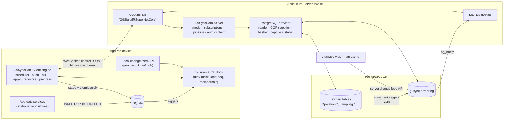
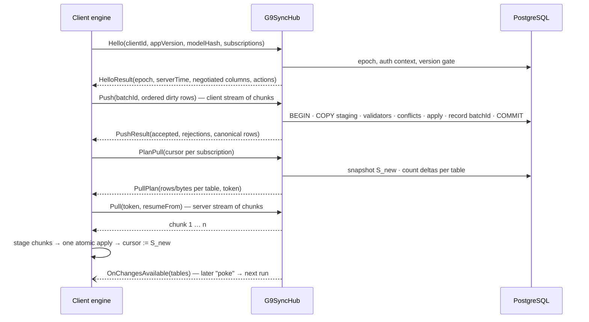

# G9SyncData — Research and Design Plan

> **Status:** DRAFT v0.1 for review. Nothing is implemented. Date: 2026-09-15.
> **Scope of v1:** PostgreSQL server ↔ SQLite client (AgriPad MAUI + `Agriculture.Server.Mobile`),
> SignalR transport on `G9SignalRSuperNetCore`. Abstractions ready for other databases later.
>
> **How to review.** Every decision has an ID (`D-xx`), every Dotmim problem has an ID (`P-xx`),
> every open question has an ID (`Q-xx`). Reply by ID ("D-07: disagree, because…") and I will revise
> this file in place.
>
> **Evidence tags used below**
> - **[Verified]** — read in our code, our Dotmim fork (`Agriculture.AgriPad/tmp/dotmim`, 1.3.18), or
>   queried on the live `agriwise` Postgres on 2026-09-15.
> - **[Spike]** — a design choice that must be proven by a measured prototype before it is built in.
> - **[Decision needed]** — needs your call; my recommendation is given.

---

## Table of contents

0. [Executive summary](#0-executive-summary)
1. [Goals, non-goals, constraints](#1-goals-non-goals-constraints)
2. [What we use Dotmim for today (full inventory)](#2-what-we-use-dotmim-for-today-full-inventory)
3. [Dotmim problems — evidence catalogue](#3-dotmim-problems--evidence-catalogue)
4. [Research: how other sync engines solve this](#4-research-how-other-sync-engines-solve-this)
5. [Architecture overview](#5-architecture-overview)
6. [Design decisions (D-01 … D-16)](#6-design-decisions)
7. [Protocol v1 (draft)](#7-protocol-v1-draft)
8. [Server design (PostgreSQL)](#8-server-design-postgresql)
9. [Client design (SQLite / MAUI)](#9-client-design-sqlite--maui)
10. [Sync progress model](#10-sync-progress-model)
11. [Provider abstraction and package layout](#11-provider-abstraction-and-package-layout)
12. [Performance plan](#12-performance-plan)
13. [Migration from Dotmim](#13-migration-from-dotmim)
14. [Delivery phases](#14-delivery-phases)
15. [Risks and mitigations](#15-risks-and-mitigations)
16. [Open questions (Q-01 … Q-14)](#16-open-questions)
17. [Sources](#17-sources)
- [Appendix A — Dotmim scope → G9SyncData subscription mapping](#appendix-a--dotmim-scope--g9syncdata-subscription-mapping)
- [Appendix B — Glossary](#appendix-b--glossary)

---

## 0. Executive summary

**What.** `G9SyncData` is a sync library that replaces Dotmim.Sync for AgriPad. PostgreSQL is the
source of truth, each device holds a SQLite replica, and the two talk over one persistent SignalR
connection (`G9SignalRSuperNetCore`).

**Why now.** Our Dotmim usage has been kept alive by a long list of workarounds: scope versions, a
non-destructive re-pull hack, a device clock gate, write-rule rewrites, classifier substring
matching, and client repair migrations. Several of the underlying defects are structural, and
some lose data silently. The most serious one is new in this analysis:

> **P-01 [Verified in code] — the server watermark can permanently skip rows.** Dotmim stamps
> server tracking rows and computes the client's new watermark from
> `extract(epoch from now())*1000` (`NpgsqlSyncAdapter.cs:25`, `NpgsqlBuilderTrigger.cs:153/199`,
> `NpgsqlScopeBuilder.cs:315`). In Postgres `now()` is the **transaction start time**, not the commit
> time. If a transaction starts before another device's sync and commits after it, its rows are
> stamped *below* the watermark that device just stored, and that device never receives them. The
> most common trigger is a long device upload under `AllOrNothing`, or a web bulk operation.
> Nothing errors. A stopgap for the current Dotmim fork is in §13.1.

**How G9SyncData is different (the decisions that matter most):**

| # | Decision | Removes |
|---|---|---|
| D-01/02 | Server change capture with **statement-level triggers + `xid8` transaction ids**; the cursor is a **Postgres snapshot** (`pg_current_snapshot()`), so selection is exact whatever order transactions commit in. Stateless, resumable. | P-01, P-13, P-24 |
| D-03 | Client capture with SQLite triggers into one metadata table, driven by a **monotonic local sequence** (no wall clock) plus a **dirty-column mask**. | P-02, P-21, P-27 |
| D-04 | **Tables are defined once; subscriptions are row sets.** Rows carry subscription membership, so unsubscribing or a row leaving a filter never wipes another subscription's rows. | P-08, P-09, P-10, P-11, P-28 |
| D-05 | **One global, ordered, idempotent push** for all local changes (batch id recorded in the same transaction). | P-12, P-20, P-22, P-23 |
| D-06 | **Stage-then-commit pull.** Chunks stream to a staging table (resumable), then apply atomically and fast. | P-26, P-15 |
| D-07 | **Hash-bucket reconciliation** replaces reinitialize and the re-pull hack. It repairs permission changes, filter changes, restores and any drift by moving only the difference. | P-08, P-09, P-24 |
| D-08 | **No more scope versions.** The client declares the columns its build understands, the server sends the intersection, and the library owns client DDL (ALTER plus a column backfill, never a full re-download). Subscription SQL is validated at server boot. | P-05, P-06, P-07, P-17, P-25 |
| D-09 | Optimistic concurrency with a per-row **base version**; column-level merge and HLC last-writer-wins available as policies. | P-21 |
| D-10 | **Rejected rows are quarantined, not fatal.** The real first error is found by bisection (never `25P02`); tables with partial unique indexes get ordered apply. | P-03, P-04, P-14 |
| D-11 | SignalR hub: typed control messages (source-generated JSON), bulk rows as **compressed binary chunks**, and **server "poke" notifications** from `LISTEN/NOTIFY`. | P-12, P-15, P-19 |
| D-12 | A **deterministic progress model**: totals known up front, bytes and rows per phase, weights learned per device, monotonic by construction. | P-18 |

**Plan shape.** Dotmim stopgaps and a baseline first (§13.1). Then five measured spikes (§14),
then the library, rolled out subscription by subscription. Dotmim and G9SyncData coexist on the
server until the fleet (72 devices today) has moved. Existing device data is **adopted without a
re-download** through reconciliation (§13.3).

**What I need from you:** the decisions in §16 — above all Q-01 (repo/packaging), Q-03 (failure
policy default), Q-05 (converting partial unique indexes to deferrable constraints) and Q-08
(keep or delete revoked data at rest).

---

## 1. Goals, non-goals, constraints

### 1.1 Goals (from the request, made measurable)

| Goal | Measured by |
|---|---|
| G1. Cover everything AgriPad does with Dotmim today | Every row of §2 has a home in §6–§9 (Appendix A) |
| G2. Postgres server + SQLite client now, other providers possible later | Provider interfaces in §11 contain no Postgres/SQLite types |
| G3. Faster than Dotmim | Benchmarks in §12 against a recorded Dotmim baseline on the same devices and data |
| G4. Easy, exact progress | §10: totals known before download, monotonic, no hand-tuned plans in the app |
| G5. Correct under concurrency, clock skew, restarts, partial failure | Property tests with concurrent writers and injected faults (§12.4) |
| G6. Schema evolution without full re-downloads | An additive column ships with 0 re-downloaded rows except that column's backfill |
| G7. Observable | Each run leaves a structured `G9DtSyncRunReport`; OpenTelemetry spans and metrics |

### 1.2 Non-goals for v1

- Peer-to-peer or multi-master between devices (the server is the only hub).
- CRDT text merging. Rows are records; column-level merge is enough for our domain.
- Replacing the attachment pipeline (`Agriculture.AgriPad.Attachments`, Couchbase). Kept separate in
  v1; possible unification later (Q-11).
- Logical replication capture. Designed for (D-01) but not built in v1.

### 1.3 Constraints [Verified]

| Constraint | Detail |
|---|---|
| Server DB | PostgreSQL **16.9**, `wal_level = replica`, `track_commit_timestamp = off`, `max_replication_slots = 10`. The server connects as a superuser with the replication attribute. |
| Server app | `Agriculture.Server.Mobile`, ASP.NET Core (.NET 10), JWT bearer scheme `"jwt"` against the OpenId authority (`StartupExtension/AuthenticationExtension.cs`). `OnMessageReceived` is commented out, so SignalR token-in-query support must be added. |
| Server state | Dotmim session is ASP.NET `ISession` over `AddDistributedMemoryCache` (30 min), so single instance and lost on restart. |
| Transport | `G9SignalRSuperNetCore` **2.5.3** is already in use (Diagnostic web server, AgriPad `LiveDiagnosticClient`). Typed hubs via source generator, `IAsyncEnumerable` streaming both ways, reconnect policy with jitter, resumable file upload/download, rate-limit attributes. JSON protocol today; MessagePack is "future opt-in". |
| Client | .NET MAUI (.NET 10), Android + iOS (TestFlight Release uses AOT) + Windows. Dotmim assemblies are currently **excluded from AOT and interpreted on iOS** to survive trimming. |
| Client DB | SQLite via `sqlite-net-pcl` (`G9MAUIControls.Persistence.Sqlite`) for app reads/writes; Dotmim uses `Microsoft.Data.Sqlite` on the same file. Per-user partition databases. |
| Devices | Low-end Android in the field (DOOGEE S99: ANR from forced GC, ~1 GB PSS with a 142k-pot map). Rural links (30 s connect budget). Android 15 caps `dataSync` foreground services at **6 h per 24 h**. |
| Fleet | 72 distinct client ids and 744 client scope rows on the server. |

---

## 2. What we use Dotmim for today (full inventory)

This is the compatibility surface G9SyncData must cover.

### 2.1 Scope catalogue (current versions) [Verified]

| Scope | Kind | Parameters (client / server-injected) | Tables | Special behaviour |
|---|---|---|---|---|
| `INITIAL_V2` | list, parameterless | — / `@Buids` | Farm (+`IsAuthorized` shadow column), Field, Block, FarmUAVImage, City, Village, Company, Region, Variety, Crop, CropCategory, CropType, GreenHouseSection, GreenHouseLine, GreenHousePotShape | Prerequisite of FARM/GREENHOUSE; must never be reset destructively; `IsAuthorized` stamped per row in `OnRowsChangesSelected` |
| `FARM_V4` | per site | `FarmId` / `@Buids` | Ridge, Pot, Placement (`IsCurrent` only), Tree, Graft (full history), CorruptTag, EntityAttributeValue, EntityAttributeValueOption | Heavy (up to 144k pots/site); geodatabase reconcile after apply; kept off background sync; keep-screen-on; polymorphic `EXISTS` filter for attribute values |
| `GREENHOUSE_V3` | per site | `SiteId` / `@Buids` | GreenHouseRow, Placement, Tree, CorruptTag, EAV, EAV option | Shares `Placement`/`Tree` with FARM; geo step is 50% of the run |
| `ATTRIBUTE_REFERENCE_V0` | reference, download-only | — | attribute categories, definitions, options, units | Prerequisite of FARM_V4 / GREENHOUSE_V3 |
| `SAMPLING_REFERENCE_V0` | reference | — | SamplingType, SampleCategory | Prerequisite of SAMPLING_DETAIL_V3 |
| `SAMPLING_DETAIL_V3` | per item | `SamplingId` | Sampling, Sample, Pick, SamplingBatch, SamplingArea, SamplingMark | Barcode validator (bulk probe); `Sample.BatchId` conflict merge; parent/child in one upload |
| `TRANSFER_DETAIL_V0` | per item | `TransferId` | TransferItem, TransferItemLog, … | Per-direction barcode gate reach depends on which transfers were opened |
| `TASK_V0` | list | — / `@AssigneePersonId` | Task (latest 1000 by `UpdatedTime`), TaskType | Assignment stamp triggers reinit |
| `USER_V0` | on-demand list | `UserIds` | User, Person | Download-only |
| `PERSON_V0` | on-demand list | `PersonIds` | Person | Shares Person with USER_V0 |
| `STATE_MACHINE_V0` | reference | — | StateMachines | Once per session |
| `STATE_TRANSITION_HISTORY_V0` | on-demand list + **upload channel** | `EntityId` (comma list) | StateTransitionHistories | Server **post-commit handler** advances entity state; **41 instances** on one device |
| `OBSERVATION_V2` | list | — / `@Buids` via Farm join | Observation | Area validator, `SummaryPoints` geometry filler, delete cascade cleanup, WKB hex geometry as text |
| `OBSERVATION_TYPE_V0` | reference, download-only | — | ObservationType | Best-effort, deliberately not a prerequisite |
| `MAP_ANNOTATION_V0` | list, bidirectional | — / `@Buids` via Farm join (site-less rows pass) | MapAnnotation | |
| `ATTRIBUTE_V0` | **server-only** | — | EntityAttributeValue | Registered only so the **web map cache can read `EntityAttributeValue_tracking`** |

Still registered for un-upgraded devices: `INITIAL_V0/V1`, `FARM_V0–V3`, `GREENHOUSE_V1/V2`, `SAMPLING_V0`,
`SAMPLING_DETAIL_V0–V2`, `TRANSFER_V0`, `OBSERVATION_V0/V1` (28 `scope_info` rows on the server).

### 2.2 Server-side features in use [Verified]

| Feature | Where |
|---|---|
| Explicit `nameof` column lists, `GloballyExcludeColumns(Buid, SerialNumber)` with per-scope opt-in | `Sync/*Scope*.cs`, `WebApplicationBuilderExtensions` |
| `SetupFilter` with parameters, custom joins, `AddCustomWhere` with `{{{token}}}` syntax, tombstone pass-through | FarmScopeV2, AttributeValueSetup, TaskScope |
| Shadow columns (`AddShadowColumn<bool>` for `Farm.IsAuthorized`) | InitialScope |
| `SyncDirection.DownloadOnly` per table | AttributeReferenceScope, ObservationTypeScope |
| Server parameter injection (`OnExecuteCommand`: `@Buids`, `@AssigneePersonId`) | `SyncController.ConfigureEvents` |
| Per-row select hook (`OnRowsChangesSelected` → `IsAuthorized`) | `SyncController` |
| Pre-apply batch hook (`OnRowsChangesApplying`): validators (1 bulk SQL per batch), geometry filler, delete cleanup | `Sync/Validation/*` |
| Conflict hook (`OnApplyChangesConflictOccured`): `BatchId` merge/throw | `SyncValidationInterceptor` |
| Error hook (`OnApplyChangesErrorOccured`): wrap SQLSTATE 23xxx into `[SYNC_APPLY_ERROR]` | `SyncValidationInterceptor` |
| Post-commit handler (StateTransitionHistory) after `HandleRequestAsync` | `SyncController.DispatchStateTransitionPostCommitAsync` |
| App version gate → HTTP 426 before any sync work | `SyncController.Post` |
| Unknown-scope response | `SyncController.WriteUnknownScopeResponseAsync` |
| Boot-time provisioning (named `ProvisionAsync`), dev deprovision helpers | `WebApplicationBuilderExtensions` |
| Implicit `text → jsonb` cast created globally at boot (side effect on the whole DB) | `WebApplicationBuilderExtensions` |
| `BatchSize = 1024 KB`, `BulkBatchMaxLinesCount = 3000` | `SyncScopes` constants |

### 2.3 Client-side features in use [Verified]

| Feature | Where |
|---|---|
| `SyncAgent` + `TunedSqliteSyncProvider` (WAL, `synchronous=NORMAL`, 100 MB cache, mmap, `busy_timeout`) | `Common/Sync/TunedSqliteSyncProvider.cs` |
| `WebRemoteOrchestrator` over `HttpClients.SyncApi` (SocketsHttpHandler, 30 s connect, keepalive) | `SyncService.GetOrCreateAgent`, `ServiceCollectionHttpClientExtensions` |
| `TransactionMode.AllOrNothing`, `DisableConstraintsOnApplyChanges`, `ErrorResolution.Throw`, `ProgressLevel.Information` | `SyncService` |
| One global agent gate; queued-sync badge; background runs pre-empted by user runs | `SyncService.Synchronize` |
| Scope prerequisites with duration-weighted progress sub-ranges | `SyncService.ScopePrerequisites`, `ScopeProgressWeights` |
| Progress: band plan per scope, arg-type phase classification, creep, monotonic guard | `SyncProgressRunContext` (885 lines), `SyncProgressPlan` |
| Pending snapshot per scope/table (`GetAllScopeInfoClientsAsync` + `GetEstimatedChangesCountAsync`) | `SyncService.GetPendingLocalChangesSnapshotAsync`, `PendingSyncService` |
| Non-destructive full re-pull (null `scope_last_sync` + `scope_last_server_sync_timestamp`) | `PrepareNonDestructiveFullRePullAsync` |
| Destructive reinitialize (operator only) | `LiveSyncControlServerHandler` |
| Permission / assignment stamps → queued re-pulls | `AppPermissionChangeCoordinator`, `ScopeReinitializationStore`, `SyncScopePermissionMap` |
| Ghost-scope guard (required parameters) | `SyncScopeParameterRequirements` |
| Background execution window (Android FGS / iOS background task), keep-screen-on | `SyncService` |
| Automatic 5-min sync with policy and sensitive-area suppression | `AutomaticSyncService`, `AutomaticSyncScopePolicy`, `SyncSensitiveAreaTracker` |
| Device clock gate (exists **only** because watermarks are wall-clock) | `Common/Services/DeviceClock/*` |
| Failure classifier (substring matching on exception text, codes `SYNC-*`) | `SyncFailureClassifier` (513 lines) |
| Cache health view, diagnostic Sync tab (health / run / clear / reinitialize) | `DotmimSyncCacheService`, `LiveSyncControlServerHandler`, Diagnostic ch. 20 |

Total client sync code in `Common/Sync` (+ `Validation/`): ~9,200 lines, plus **33 `Synchronize` call sites in 22 files**.

### 2.4 Code that reads Dotmim-owned tables directly (hidden contracts) [Verified]

| Consumer | Reads | Why it matters |
|---|---|---|
| `GeoSyncDataService` / `GeoSyncCoordinator` | `Pot/Tree/Placement/Graft _tracking.timestamp` | The map's incremental geo pass is built on Dotmim's tracking shape |
| Web app map cache (server) | `EntityAttributeValue_tracking` | The reason `ATTRIBUTE_V0` exists at all |
| `ScopeSyncStateReader` | `scope_info_client.scope_last_sync` | "Has this scope ever synced" UI |
| `DotmimSyncCacheService`, `DotmimSyncCacheView` | `sync_scope_errors`, batch directory | Health view |
| `ScopeReinitializationStore`, `AppPermissionChangeCoordinator`, `TasksViewModel`, `QaProbeRegistry` | scope names / scope rows | Repair and QA flows |
| Migrations `1_0_0_8`, `_10`, `_12`, `_16` | retire `scope_info_client` rows, repair `_tracking` rows | Dotmim never alters its own state |

### 2.5 Measured data volume (live `agriwise`, 2026-09-15) [Verified]

| Table | Est. rows | Size |
|---|---:|---:|
| Operation.Tree | 2,091,518 | 607 MB |
| Operation.Placement | 1,448,836 | 1,044 MB |
| Operation.Pot | 1,255,726 | 393 MB |
| Operation.Tree_tracking (Dotmim) | 369,485 | 63 MB |
| Sampling.Pick | 237,699 | 101 MB |
| Transfer.TransferItemLog | 217,773 | 64 MB |
| StateManagement.StateTransitionHistories (+ tracking) | 216,025 (+215,985) | 121 MB (+39 MB) |
| Graft.Graft | 182,650 | 53 MB |

Largest sites by pots: **144,316 · 142,214 · 119,676 · 108,938 · 60,560**. Dotmim triggers on the
server: **144**. Partial unique indexes on synced tables: `IX_Placement_PotId`,
`IX_Placement_TreeId`, `IX_Placement_GreenHouseRowId_GreenHouseIndexInRow`, `IX_Graft_TreeId_IsCurrent`.
Recorded device example (chapter 20): 689 MB SQLite, 60k trees/placements/pots, 36k grafts, 14 site
scope instances.

---

## 3. Dotmim problems — evidence catalogue

Each problem lists its evidence and the decision that removes it.

### 3.1 Correctness (silent data loss or divergence)

| ID | Problem | Evidence | Fixed by |
|---|---|---|---|
| **P-01** | **Server watermark race.** The tracking timestamp and the new watermark are both `now()` (transaction *start* time). A transaction that starts before a sync and commits after it is stamped below that sync's watermark → **its rows are never delivered to that device**. Most likely source: another device's long `AllOrNothing` upload, or a web bulk operation. | `NpgsqlSyncAdapter.TimestampValue = "(extract(epoch from now())*1000)"`; used by triggers and by `GetLocalTimestampCommand` | D-01, D-02; stopgap §13.1 |
| **P-02** | **Client watermark is the device wall clock.** A clock moving backwards strands local rows. The fork's monotonic counter (`UseMonotonicTimestamp`) is not enabled by the app and only applies to databases provisioned after it is set. | Fork commit `ae88323`; app has no `UseMonotonicTimestamp` reference; the whole device-clock-gate subsystem exists for this | D-03 |
| **P-08** | **Filters only select; nothing ever leaves.** A row that stops matching (permission revoked, `IsCurrent` flipped, task unassigned, top-1000 cap) stays on the device. Grants need stamp flows plus the two-column re-pull hack; `IsAuthorized` is only re-stamped on rows that happen to be re-selected. | Ch. 03 "Filtered scopes & permission changes"; ch. 20 | D-04, D-07 |
| **P-09** | **Reinitialize deletes every row of every table in the scope, unfiltered.** Shared tables (Placement/Tree across 14 site instances) are wiped and only one instance is refilled. | `BaseOrchestrator.ApplyChanges.cs:~70`; ch. 20 §3–§4 | D-04, D-07 |
| **P-11** | **Several scopes owning one table**, each with its own watermark and full reset authority (the `SAMPLING_V0` incident). | Ch. 03 "SAMPLING_DETAIL_V3 is the SOLE owner" | D-04 |
| **P-21** | **Row-level conflicts, whole-row uploads.** A stale copy overwrites columns the user never touched (`Sample.BatchId` silently removed); `ServerWins` discards client edits without telling anyone; `UpdatedTime` heuristics. | `AiGuide-Dotmim-Sync-Validation.md` "Known limitation" | D-03, D-09 |
| **P-22** | **Uploads are not idempotent.** A retry after a lost response re-applies the batch, and the StateTransition post-commit handler can fire again. | `SyncController.Post` dispatches post-commit after every `HandleRequestAsync` | D-05 |
| **P-23** | **Uploads are not authorized per row.** Scope filters are selection-only; nothing in the apply orchestrators evaluates them, so a client can upload a row of any table in the scope, for any farm. | No filter use in `Orchestrators/ApplyChanges/*` | D-05 (write rules) |
| **P-24** | **No tombstone horizon.** Tracking tables grow forever (Tree_tracking 369k rows), and there is no "client too far behind" protocol. A database restore resets nothing the clients can detect. | §2.5 | D-02 (horizon + epoch), D-07 |

### 3.2 Robustness (wedges and stuck states)

| ID | Problem | Evidence | Fixed by |
|---|---|---|---|
| **P-03** | **Unordered apply vs partial unique indexes.** A retire-then-insert reaches Postgres in the wrong order → `23505` → every later statement returns `25P02`, the only error the device sees. | Memory/ITCS-15514; ch. 03 header | D-10 |
| **P-04** | **One poison row blocks the whole scope forever**, upload *and* download, because every retry replays the same batch (48 rows stranded by 2 placements; blank-id row wedge). | Ch. 03 post-mortems | D-06, D-10 |
| **P-10** | **Scope identity = name + case-sensitive parameter hash.** GUID casing doubles downloads (10 rows for 5 samplings); a null parameter means **no filter** (the 280k-tree "ghost" download). | Ch. 03 "SyncParameter VALUES are hashed CASE-SENSITIVELY" | D-04 |
| **P-26** | **One huge device transaction per run** (300k+ rows): the app write lock is held for the whole apply, WAL grows, and cancellation during apply cannot be honoured. | `AllOrNothing` unconditional | D-06 |
| **P-13** | **Server session in in-memory `ISession`**: single instance only, a server restart kills in-flight syncs. The fork's resumable orchestrator is unused. | `WebApplicationBuilderExtensions`, ch. 20 §6b | D-02 |

### 3.3 Schema and provisioning

| ID | Problem | Evidence | Fixed by |
|---|---|---|---|
| **P-05** | **Scope schema frozen at first provisioning.** Every column/table change needs a new scope name, and every device re-downloads the whole scope per site (FARM V0→V4 = 4 full re-downloads). | Ch. 03 "Additive columns on an already-synced table" | D-08 |
| **P-06** | **Client tables never ALTERed**, so drift in both directions (`Variety.NeedsGraft`, `Farm.Type`, `Placement.Status`) and mirror-entity crashes (`Tree.PotId`, `CorruptTag.Buid`). | Ch. 03 post-mortems, migrations 12/13/16 | D-08 |
| **P-07** | **Provisioning traps**: `ProvisionAsync(setup)` provisions `"DefaultScope"`; DDL runs inside a tablet's first sync; a bad filter fails on a device, not at boot. | Ch. 03 "Provisioning MUST NAME THE SCOPE" | D-08 (boot validation) |
| **P-17** | **No secondary indexes** on client tables (only the PK), so child-table scans (49.8 ms → 6.7 ms after `Migration_1_0_0_14`). | Ch. 03 "Dotmim indexes NOTHING but the primary key" | D-08 (declared indexes) |
| **P-25** | **Type friction**: global implicit `text→jsonb` cast, `interval` unsupported, geometry/arrays as text. | `WebApplicationBuilderExtensions`, ch. 03 task time columns | D-08 (type mapping) |

### 3.4 Performance and resources

| ID | Problem | Evidence | Fixed by |
|---|---|---|---|
| **P-12** | **One session and several HTTP round trips per scope.** For small scopes the connect/`BeginSession` wait is ~55% of the run; a 12-scope flush = 12 sessions. | `SyncProgressPlan` weights; `PendingSyncService` | D-05, D-11 |
| **P-14** | **Bulk apply toggles triggers with DDL inside the apply transaction.** Server: `ALTER TABLE … DISABLE/ENABLE TRIGGER` (the fork's own comment says it needs AccessExclusive), which blocks concurrent web writes to that table until the device's transaction commits. Client: `DROP TRIGGER` / recreate. | `NpgsqlSyncAdapter.Batch.cs:361-372`, `SQLiteSyncAdapter.Batch.cs:DropTriggersAsync` | D-01 (origin via `SET LOCAL`), D-03 (context flag) |
| **P-15** | **JSON batch files on disk, reflection serializer, per-row object graphs**; on iOS Dotmim runs **interpreted** to survive AOT stripping. | csproj `MtouchInterpreter`, `AndroidAotExclude`; ch. 18 §7e | D-11, D-14 |
| **P-16** | **Forced blocking GC per scope** (the DOOGEE ANR). Fixed in fork 1.3.18, not shipped. | `SyncAgent.cs:490` | D-14 |
| **P-20** | **Pending counts cost a select-changes per scope through the global agent gate**; status reads wait behind a running sync (5 s gate timeouts in `TaskExecutionLocalDataGate`). | Ch. 03 task gate notes | D-13 |
| **P-28** | **Scope explosion** for on-demand lists (41 history scopes on one device). | Ch. 03 GC section | D-04 (ephemeral subscriptions) |

### 3.5 Progress and observability

| ID | Problem | Evidence | Fixed by |
|---|---|---|---|
| **P-18** | **No totals up front.** Phases guessed from arg types; out-of-order batch indexes; stale-band events; hand-tuned weights; time-based creep; two shipped "stuck at 100%" defects. | Ch. 03 "Sync Progress UI" | D-12 |
| **P-19** | **Errors travel as string markers inside exception messages** inside a JSON envelope; the client classifies by substring. | `[SYNC_VALIDATION]`, `[SYNC_APPLY_ERROR]`, `[SYNC_CONFLICT]` | D-11 (typed errors) |
| **P-27** | **Undocumented consumers of Dotmim internals** (§2.4). | §2.4 | D-03, D-15 (change feed APIs) |

Upstream reports confirm the performance and large-table limits are not ours alone (request-size
413s, command timeouts on multi-million-row tables, completed-transaction errors on large data,
hangs after big downloads) — see Sources.

---

## 4. Research: how other sync engines solve this

| System | Mechanism | Adopted in G9SyncData | Rejected / deferred |
|---|---|---|---|
| **PowerSync** | Logical replication into an op-log; data partitioned into **buckets**; clients hold checkpoints; local writes go to a FIFO upload queue (`ps_crud`); **write checkpoints** make sure a client's own uploads are acknowledged before server state is applied over them. | Ordered upload queue (D-05), checkpoint-consistent apply that never overwrites un-acknowledged local rows (D-06), subscriptions ≈ buckets (D-04) | Separate replication service + op-log storage (too much infrastructure for v1; `wal_level` change) |
| **PowerSync on logical replication** | Documents real pitfalls: no DDL in the stream, LSNs not monotonic, unchanged TOAST columns missing, `REPLICA IDENTITY` variations. | Evidence that logical replication is a *later* option, behind an interface (D-01) | — |
| **ElectricSQL** | Logical replication → **shapes** (filtered row sets) served over HTTP with an **offset** cursor; `409 must-refetch` when a shape is invalidated; subquery shapes need move-in/move-out handling. | Opaque resumable cursor in each request (D-02); explicit "resync required" signal (D-07); move-in/out as a first-class problem (D-07) | Rebuilding a whole shape on filter changes (we reconcile the difference instead) |
| **Replicache / Zero** | **Push/pull**: client mutations carry a monotonic `mutationID`; the server records `lastMutationID` **in the same transaction** as the effects; handlers must be idempotent; the server "pokes" clients to pull. | Idempotent push with batch id recorded atomically (D-05); poke notifications (D-11) | Speculative client mutators (our app writes rows directly) |
| **CommunityToolkit.Datasync** | EF Core `OfflineDbContext`, per-entity version/`UpdatedAt`, REST push/pull. | Per-row version for optimistic concurrency (D-09) | Requires EF Core on device and entity-level REST; no filtered partial replication at our scale |
| **Postgres outbox with `xid8`** | Commit-order-safe polling: filter by `pg_current_xact_id()` and read only below `pg_snapshot_xmin(pg_current_snapshot())`. | The core of D-02, extended to the exact snapshot-difference predicate | Sequence/timestamp watermarks (the P-01 bug) |
| **HLC / LWW (Couchbase, ObjectBox, Ubiquisync)** | Hybrid logical clocks give deterministic last-writer-wins under skew; per-column LWW and "max-wins" columns. | Optional LWW policy per table/column (D-09) | LWW as the default (field data is safer with base-version checks) |
| **SQLite session extension** | Binary changesets with conflict handlers. | — | Rejected: records per connection only (our app writes through sqlite-net *and* Microsoft.Data.Sqlite) and availability varies across bundled SQLite builds |
| **Npgsql bulk ingest benchmarks** | `UNNEST` competitive up to ~10k rows; **binary COPY wins above**; COPY needs a staging table for upserts. | COPY → staging → set-based apply; `UNNEST` for small pushes (D-10, §8.5) | Row-by-row statements for non-ordered tables |
| **SignalR** | Default `MaximumReceiveMessageSize` 32 KB; streaming invocations are exempt from the parallel-invocation limit; stateful reconnect buffers only ~100 KB; the MessagePack protocol is **not** AOT-safe (`Nerdbank.MessagePack.SignalR` is); JSON protocol is AOT-safe with source-generated contexts. | Binary chunk payloads, app-level resume, JSON source-gen now, Nerdbank MessagePack later (D-11) | Relying on stateful reconnect for data |

---

## 5. Architecture overview



**One sync run (all subscriptions due, one connection):**



---

## 6. Design decisions

### D-01 — Server change capture: statement-level triggers writing `xid8`

**Context.** We need to know which rows changed and when, relative to commit visibility (P-01), with
minimal cost on OLTP writes from the web app (bulk plants of 100k+ pots) and without DDL during apply
(P-14).

**Options.**
1. *Dotmim-style row triggers with timestamps* — the source of P-01. Rejected.
2. *Logical replication* (pgoutput) like PowerSync/Electric — no write-path cost, but needs
   `wal_level=logical` (restart), replication-slot WAL retention risk, TOAST handling, and our own
   op-log store. **Deferred behind `IG9ChangeCaptureSource`.**
3. *Statement-level `AFTER` triggers with transition tables* (`REFERENCING NEW TABLE / OLD TABLE`),
   stamping `pg_current_xact_id()`. One set-based insert per statement instead of one per row.
   **Chosen.**

**Decision.**
- One tracking table per synced table, in a dedicated schema `g9sync` (domain schemas stay clean):
  PK columns, `xid xid8`, `deleted bool`, `origin_client uuid null`, `changed_at timestamptz`
  (diagnostic only, never used for selection).
- Three triggers per table (Postgres only allows transition tables on single-event triggers).
- The UPDATE trigger records a row **only when a captured column actually changed**
  (`(n.c1, n.c2, …) IS DISTINCT FROM (o.c1, o.c2, …)`). An update to an unsynced column
  (`SerialNumber`, a heavy server-only geometry) no longer triggers a download of that row.
  Types with unreliable `=` (PostGIS geometry) are compared as `::text` or with a type-specific
  comparer chosen by the generator.
- Echo suppression without DDL: the sync server runs `SET LOCAL g9sync.origin = '<clientId>'`
  inside its apply transaction, and the trigger reads `current_setting('g9sync.origin', true)`.
  **No `ALTER TABLE … DISABLE TRIGGER`, ever.**
- The statement trigger calls `pg_notify('g9sync', '<table_id>')`. Postgres delivers at commit and
  collapses duplicates within a transaction (feeds D-11 pokes).
- Capture DDL is installed by an idempotent installer under an advisory lock at boot, **or** emitted
  as a reviewable SQL script for production (`g9sync script`), matching how production migrations
  are run today.

**Consequences.** Write-path cost is one extra set-based statement per DML statement. It must be
measured with a web-style bulk write (Spike S1). Dotmim's triggers can coexist during migration.

### D-02 — Exact, stateless cursor: the Postgres snapshot

**Decision.** A subscription cursor is the text of a `pg_snapshot` (`xmin:xmax:xip_list`) captured
at the start of the pull that produced it, plus the server **epoch** (below). A pull selects:

```text
rows whose tracking xid is NOT visible in S_prev   (changed since the last pull)
                 AND IS visible in S_new            (committed before this pull began)
```

using `pg_visible_in_snapshot(xid, snapshot)`, with `xid >= pg_snapshot_xmin(S_prev)` as the indexed
range predicate. Why this is exact:
- A transaction still in progress at `S_prev` is invisible in `S_prev` → selected when it has
  committed, **whatever order commits happened in** (removes P-01).
- A row updated after `S_new` gets a newer xid → excluded from this pull → included in the next.
- Pages use keyset pagination on the PK with `S_new` fixed in the resume token, so **a reconnect
  resumes on any server instance** with no session store (removes P-13).
- Duplicates can happen (a row's data read on a later page may already be newer); apply is an
  idempotent upsert keyed by version, so they are harmless.

**Epoch.** `g9sync.install.epoch` is a GUID created on install. xid counters are not comparable
across a dump/restore to another cluster (the pre-production migration workflow does exactly that).
A client whose stored epoch differs gets `ResyncRequired` → reconciliation (D-07), never a silent
skip.

**Tombstone horizon.** A cleanup job deletes `deleted = true` tracking rows older than a configured
horizon (e.g. 30 days) and records the horizon xid. A cursor older than the horizon gets
`ResyncRequired` → reconciliation. Tracking tables stop growing forever (P-24).

**[Spike S1]** Prove with concurrent writers, long transactions and killed connections that no row
is lost or double-applied. Measure `pg_visible_in_snapshot` cost on large deltas. Confirm btree
ordering on `xid8` in PG16; fallback: store `xid::text::bigint`.

### D-03 — Client capture: triggers → one metadata table, monotonic sequence, dirty mask

**Options.** Repository interceptors (miss raw SQL writes such as `PlacementWriteRules` and
migrations); the SQLite session extension (per connection only — rejected); per-table Dotmim-style
tracking tables; **one metadata table fed by generated triggers (chosen)**.

**Decision.**
- `g9_rows(tid, pk, server_ver, local_seq, dirty, dirty_mask, hlc_ms, subs, rejected)` — one row per
  synced row (`WITHOUT ROWID`). This replaces every `<Table>_tracking`.
- `g9_clock.seq` is a **monotonic counter**, bumped by every capture trigger. No wall clock anywhere
  in change detection → **the device clock gate is no longer needed for sync correctness** (P-02).
  It can stay as a UX safeguard for business timestamps.
- UPDATE triggers compute `dirty_mask` by comparing `OLD.col IS NOT NEW.col` per synced column and
  OR it into the stored mask. INSERT sets all bits; DELETE sets `dirty = 2`. Uploads send **only
  changed columns** → no stale column overwrites (P-21: the `BatchId` case disappears without
  heuristics).
- Library writes during apply are not captured, **without DDL**. The apply transaction sets
  `g9_ctx.applying = 1` and resets it before `COMMIT`. Triggers have `WHEN (SELECT applying FROM
  g9_ctx) = 0`. SQLite has a single writer, so no other connection can write while the flag is 1,
  and a crash rolls it back to 0. (Replaces Dotmim's `DROP TRIGGER`/recreate, P-14.)
- A **local change feed API**, `ChangeFeed.ReadAsync(table, sinceSeq, limit)`, covers both downloaded
  and local writes. `GeoSyncCoordinator` moves to it instead of reading `_tracking.timestamp` (P-27).
- GUID primary keys are stored in `g9_rows.pk` as canonical lower-case text in v1 (safe across both
  SQLite libraries in the process). A 16-byte BLOB is a later optimisation if Spike S3 shows a win.

### D-04 — Tables are global; subscriptions are row sets with membership

**Context.** Dotmim scopes bundle *tables*, *filters*, *parameters* and *a watermark* into one frozen
unit per instance. That single choice produces P-05, P-08, P-09, P-10, P-11, P-28.

**Decision.**
- **Sync model** = tables (columns, PK, direction, conflict policy, validators), each defined **once**.
- **Subscription** = a named, parameterised set of rows over one or more tables, each with its own
  predicate:
  - **Persistent** — `site-farm(FarmId)`, `reference-initial`, `sampling(SamplingId)`: kept in sync.
  - **Ephemeral** — `people(PersonIds)`, `state-history(EntityIds)`: fetched on demand with a TTL.
    Rows share one "ephemeral" membership slot and are garbage-collected after the TTL when no
    persistent subscription holds them (removes 41-instance bloat, P-28).
- **Membership:** `g9_rows.subs` is a bitmask of local subscription slots (≤ 63; an overflow table
  covers more). A row is deleted locally only when **no** subscription holds it and it has no pending
  local change. Unsubscribing a farm, or a row leaving a filter, never touches another farm's shared
  `Placement`/`Tree` rows (P-09, P-11).
- **Parameters are typed and normalised** by the library (GUIDs canonicalised, required parameters
  enforced, lists sorted and de-duplicated before hashing). A missing required parameter is a
  compile/validation error, never "no filter" (P-10).
- **Dependencies:** `DependsOn("reference-initial")` is declared on the subscription. The engine
  orders a run, shows one combined progress plan (D-12), and fails fast if a required parent fails;
  optional/decorative parents are `DependsOn(…, required: false)`.
- **Tombstones** carry no row data, so they cannot be filtered server-side. They go to every
  subscriber of the table and the client ignores keys it does not hold. Deletes are rare, so this is
  cheap (same trade-off Dotmim made).

### D-05 — Push: one global, ordered, idempotent, authorised upload

**Decision.**
- **Push is independent of subscriptions.** Every dirty row of every table goes in one push, ordered
  by `local_seq` (causal order of the device's writes). "Which scope owns this pending change" and
  the 12-session flush disappear (P-12, P-20).
- Each push has a client-assigned monotonic `batchId`. The server applies the rows and updates
  `g9sync.clients.last_push_batch` **in the same transaction**. A retried batch whose id is ≤ the
  recorded one is acknowledged without re-applying (Replicache rule). Post-commit handlers key on
  `(clientId, batchId)` → at most once (P-22).
- **Write rules:** every table declares who may write which rows (`CanInsert/CanUpdate/CanDelete`
  predicates in SQL, evaluated set-based against staging with the caller's auth context). Rows that
  fail are rejected with `G9S-REJ-PERMISSION`, not applied (P-23).
- Every uploaded row carries its **base version** (`server_ver` last seen) and the **dirty column
  mask** (D-09).
- Acknowledgement clears `dirty` only for rows whose `local_seq` ≤ the pushed sequence, so a row
  edited again during the push stays dirty.

### D-06 — Pull: plan → stream → stage → atomic apply

**Decision.**
1. **Plan** — the server takes `S_new`, counts delta rows and estimates bytes per table per
   subscription, and returns the totals plus a resume token (drives D-12).
2. **Stream** — the server streams compressed binary chunks (D-11). The client writes each chunk
   as-is into `g9_stage` (append-only, no indexes, cheap) and records the last chunk number. A kill
   or disconnect resumes from `resumeFrom = lastChunk + 1` (P-04, P-26).
3. **Apply** — when all chunks are staged, **one** short write transaction decodes them and applies
   set-based upserts/deletes, updates `g9_rows` (server version, membership), advances cursors, and
   clears the stage. The app's write lock is held only for this final step (seconds), not for the
   whole network transfer (P-26).
4. **Local pending protection** — a downloaded row whose `g9_rows.dirty <> 0` is **not overwritten**.
   The next push resolves it, and the canonical row comes back in the push result (PowerSync's
   write-checkpoint rule, simplified).
5. **Download no longer depends on upload success.** Rejected rows are quarantined (D-10), so a bad
   local row never blocks new server data (P-04).

Very large initial seeds can optionally use a **server-generated snapshot file** downloaded with
`G9CFileDownloader` (resumable, SHA-256 verified, already in `G9SignalRSuperNetCore`) and applied
the same way. **[Decision needed → Q-07]**

### D-07 — Reconciliation instead of reinitialize

**Context.** Permission changes, filter definition changes, row caps, restores and any undetected
drift need "make my copy equal to the server's current set", without deleting everything (P-08, P-09,
P-24) and without re-downloading everything.

**Decision.** Range-based set reconciliation over hash buckets:
- For a subscription and table, the server computes `(bucket, count, xor(hash(pk, version)))` over
  the rows **currently matching the predicate** with the **current** auth context. Bucket = first
  byte of the UUID (uniform for random GUIDs) → 256 buckets. Hash = the first 64 bits of
  `md5(lower(pk) || ':' || version)`, which is portable and computed identically in C#.
- The client computes the same over its rows that are members of that subscription (the digest can
  be kept incrementally in `g9_bucket_digest` during apply, making it O(256)).
- Buckets that differ are refined (to 65,536 sub-buckets, then PK lists). The server then sends
  **move-ins** (rows as normal pull chunks) and **move-outs** (membership removal → local delete if
  unheld and clean).
- Triggers: epoch change, tombstone horizon exceeded, subscription `definitionHash` changed (the
  filter SQL was edited), `authContextHash` changed (the user's business units/permissions changed —
  computed server-side, **no app stamp plumbing needed**), operator "repair" command, and an optional
  periodic safety check (e.g. weekly per subscription).
- Computed columns that depend on the auth context (`Farm.IsAuthorized`) are part of the row hash
  input, so a permission change re-sends exactly the rows whose computed value flipped.

**Result.** The destructive reinitialize, `PrepareNonDestructiveFullRePullAsync`,
`ScopeReinitializationStore`, `SyncScopePermissionMap` and the assignment/permission stamps all
collapse into one library mechanism. **[Spike S5]** measures hash cost for the 144k-pot site on the
server and on a low-end device.

### D-08 — Schema evolution without scope versions

**Decision.**
- **Server model** in C# with explicit columns (`nameof`), so the compile-time drift tripwire is
  kept. The server computes a hash per table definition.
- **Client model** is **source-generated from the mirror entities** (`[G9AttrSyncTable]` on the
  existing `Common/Entities/*Entity.cs`). The entity is the single source of truth for the client's
  column set; the generator also emits AOT-safe row binders (no reflection).
- **Negotiation at `Hello`:** the client sends its model (tables → columns → types). The server
  answers, per table, with the columns it will send = client columns ∩ server columns. For a column
  the client wants but the server no longer has: the model declares
  `RemovedColumn("Type", defaultValue: 0)` (server sends the default) or blocks with
  `G9S-SCH-UPGRADE` naming the table and column. **Old app builds keep working on their old column
  set; new builds get new columns. No new scope name, ever.**
- **The library owns client DDL** for synced tables. It creates the table from the generated model,
  `ALTER TABLE ADD COLUMN` for a new column, rebuilds a table safely for a dropped/retyped column
  (dropping dependent indexes first, per ch. 03), and creates **declared secondary indexes**
  (`[G9AttrSyncIndex]`) (P-06, P-17).
- **Column backfill:** after adding a column, the client requests just that column for rows it
  already holds (`Pull(columns=[NeedsGraft])`), so only a narrow projection transfers — not the rows.
- **Boot-time validation:** at server start every subscription predicate and column list is compiled
  and checked with `EXPLAIN` against the live database (column exists; NOT NULL without default
  covered; types mappable). A bad model fails the **server boot**, never a tablet sync (P-07).
- **Type mapping** is explicit per column (`AsText(WkbHex)`, `AsJsonText()`, `AsUuidArrayText()`,
  `interval → ticks bigint`). The apply uses typed casts in SQL, so no global `text→jsonb` cast is
  needed (P-25).

### D-09 — Conflict handling

**Decision.**
- **Default: optimistic concurrency on the row base version.** An upload whose `base_ver` equals the
  server's current tracking xid applies. Otherwise it is a conflict handled by the table's policy:

| Policy | Behaviour |
|---|---|
| `ServerWinsOnConflict` (default) | Server keeps its row; client edit is **reported** (`G9S-CON-SERVER-WINS`), and the canonical row is returned and applied locally. Never silent. |
| `ColumnMerge` | Apply the client's dirty columns that the server did **not** change since the base; conflict only on overlapping columns. Needs per-column versions in the tracking table (opt-in per table: `+8 bytes × columns` per tracked row). |
| `LastWriterWins(Hlc)` | Compare hybrid logical clocks (server-anchored milliseconds + counter + node). Clock-skew tolerant. |
| `ClientWins` | For device-owned data (e.g. `SamplingMark`). |
| `Custom(IG9ConflictResolver<T>)` | C# resolver with typed rows; returns Keep/Accept/Merge(row)/Reject(code). |

- `Sample` uses `ColumnMerge`: `BatchId` changed on one side and title on the other both survive. Only
  a real concurrent `BatchId` change is a conflict. This is the "fully robust fix (d)" deferred in the
  validation guide, now available without a domain schema change because versions live in
  `g9sync.*`.
- HLC is stamped at push time from `g9_rows.hlc_ms` (device time when captured) corrected by the
  server clock offset measured at `Hello`. It only matters for LWW tables.

### D-10 — Upload failures are isolated, and the real error is found

**Decision.**
- The server applies a push inside one transaction, **table by table in FK dependency order**
  (parents first for upserts, children first for deletes), with a `SAVEPOINT` per table chunk.
- **On error:** roll back to the savepoint and **bisect** the chunk (nested savepoints) to find the
  failing rows. Each gets a structured rejection with its **own** `SQLSTATE`, constraint and column
  (never `25P02`). The rest applies. Dependent rows (children of a rejected parent) fail and are
  rejected in turn with their FK error. Cost: O(k·log n) per k bad rows; above a cap
  (`MaxRejectionsPerPush`, e.g. 50) the whole push fails with `G9S-REJ-TOO-MANY` (protects against
  a systematic bug).
- **Client side:** rejected rows get `g9_rows.rejected = 1` plus a `g9_rejections` record (code,
  detail JSON, time). They are **not re-sent until the row is edited again** (which bumps
  `local_seq`) or the user/app explicitly retries. The UI can list "3 items could not be uploaded"
  with a reason. Downloads continue.
- **Failure policy per push** **[Decision needed → Q-03]**: `IsolateRejections` (recommended default)
  or `AllOrNothing` (today's behaviour) for flows that truly need atomicity. A table group can also
  be declared atomic (`Sample` + `Pick` must land together).
- **Ordered apply for tables with extra unique indexes.** At boot the provider detects unique
  indexes other than the PK (today: `Placement` ×3, `Graft` ×1) and applies those tables **in
  `local_seq` order** with a pipelined `NpgsqlBatch` of prepared statements (one round trip, device
  order preserved). Other tables use COPY → staging → set-based apply. The retire-then-insert that
  wedged ITCS-15514 then applies in the order the device wrote it.
- **Recommended database change** **[Decision needed → Q-05]**: replace the partial unique indexes
  with `EXCLUDE USING btree ("PotId" WITH =) WHERE ("IsCurrent") DEFERRABLE INITIALLY DEFERRED`
  (and the same for the others). Checks move to commit, so ordering no longer matters for *any*
  writer, the web app included. The client write rules (`PlacementWriteRules`) stay as defence.

### D-11 — Transport on `G9SignalRSuperNetCore`

**Decision.**
- **One hub** `G9SyncHub : G9AHubBase<G9SyncHub, IG9SyncHubListeners>`, mapped with
  `.RequireAuthorization()` using the existing `"jwt"` scheme (add `OnMessageReceived` to read
  `access_token` for the `/g9sync` path — the standard SignalR bearer pattern). The typed client
  comes from the G9 source generator.
- **Control messages** (Hello, plans, results, rejections, status) are small DTOs over the JSON hub
  protocol with a **source-generated `JsonSerializerContext`** (AOT-safe; same pattern as
  `LiveDiagnosticJsonContext`).
- **Row data travels as binary chunks** (`G9RowBatch` format, §7.4): row-oriented, typed columns,
  null bitmap, varints, 16-byte UUIDs, UTF-8 strings. Compressed with **Brotli** (inbox in .NET 10);
  the codec is negotiated so **zstd** (inbox in .NET 11) can replace it. Target chunk 256–512 KB
  compressed; server `MaximumReceiveMessageSize` raised accordingly (the Diagnostic hub already uses
  8 MiB).
- **JSON protocol base64-encodes `byte[]` (+33%).** Phase 1 accepts that. Phase 2 adds an AOT-safe
  **MessagePack protocol to `G9SignalRSuperNetCore`** based on `Nerdbank.MessagePack.SignalR`, so
  chunks travel as native binary frames. **[Decision needed → Q-06]**
  > **Status 2026-09-17: built** — G9SignalRSuperNetCore 2.6.0 ships `.Server.MessagePack` / `.Client.MessagePack`;
  > G9SyncData defaults to it (library ADR-0039): 25% fewer bytes, half the client allocations, measured on the
  > Android emulator. Zstandard was measured and **not adopted** (no gain over Brotli q4; ADR-0043); a
  > column-grouped `G9RowBatch` layout 2 gained 11–15% instead (ADR-0040).
- **Streams:** `Pull` returns `IAsyncEnumerable<G9DtSyncChunk>` with `[G9AttrStreamBackpressure]`;
  `Push` takes `IAsyncEnumerable<G9DtSyncChunk>` from the client. Resumes are app-level (chunk
  numbers + token). SignalR stateful reconnect is **not** relied on (its buffer is ~100 KB by
  default).
- **Pokes:** every server instance runs `LISTEN g9sync`. On a notification it maps the table to the
  subscriptions that include it and sends `OnChangesAvailable(subscriptionKeys)` to connected clients
  holding those subscriptions (G9 groups per subscription key), throttled and coalesced (e.g. at most
  once per 5 s per client). Office edits reach an open tablet in seconds. **No backplane is needed**:
  each instance listens to Postgres and notifies only its own connections.
- **Typed errors:** every failure is a `G9DtSyncError { Code, Category, Retryable, Table?, RowKey?,
  SqlState?, Constraint?, Details? }`. The app classifier becomes a `switch` on `Code` (P-19).
- **Connection lifecycle on mobile:** connect when the app is foreground or a run starts; drop the
  idle connection after N minutes in the background. A foreground service is held **only during a
  run**, never for an idle connection (Android 15's 6 h/24 h `dataSync` budget). The G9 reconnect
  policy (capped exponential backoff with jitter) replaces the custom loop that caused the
  `LiveDiagnosticClient` reconnect storm.
- **Fallback:** where WebSockets are blocked, SignalR falls back to SSE/long polling (control still
  works; bulk is slower). The optional snapshot file download (D-06) covers big seeds on such
  networks.
  > **Status 2026-09-17: snapshot file download rejected by measurement** (library ADR-0041): the compressed
  > file is 44% larger than the frames it replaces and saves ~1.9 s of device load at 500,000 rows — break-even
  > only above ~30 Mbit/s.

### D-12 — Progress model (summary; full detail §10)

Totals are known before download (plan step). Progress is bytes and rows per phase. Phase weights
are learned per device and subscription (EWMA of past runs). Monotonicity is enforced once, inside
the library. One combined plan covers dependencies. App-owned post-steps (the geodatabase reconcile)
get a reserved slot. Events are throttled and carry codes, not strings.

### D-13 — Client scheduling and concurrency

**Decision.**
- **One engine per database** with a priority queue: `UserInteractive > Foreground > Background`. A
  user run pre-empts a background run at the next safe point (between chunks; apply is atomic).
  Identical requests coalesce (two "sync farm X" calls → one run, both awaiters complete).
- **Status reads never wait for a running sync.** Pending counts, last success, rejections and
  subscription state are plain reads of `g9_rows` / `g9_subscriptions` (indexed, < 5 ms). This
  removes the 5 s gate timeouts in `TaskExecutionLocalDataGate` (P-20).
- **Pending summary is incremental:** `SELECT tid, dirty, count(*) FROM g9_rows WHERE dirty <> 0
  GROUP BY tid, dirty` (partial index).
- **Automatic sync policy is data, not code:** subscriptions declare `SyncCadence` (`OnPoke`,
  `Every(5 min)`, `OnDemand`, `ForegroundOnly`) and `Heavy = true` (never started in the background).
  Suppression scopes (`SyncSensitiveAreaTracker`) become an engine API
  (`engine.SuppressBackground()` returning a disposable).
- Host integration points for the app: `IG9SyncHostHooks` (background execution window, keep-screen-on,
  connectivity probe, auth token provider, version-gate UI).

### D-14 — Memory, GC and AOT engineering

- No per-row object graphs. Chunks decode with `SequenceReader<byte>` straight into prepared-statement
  parameter binds. Buffers come from `ArrayPool<byte>`. Staging stores compressed bytes.
- **No `GC.Collect`** anywhere in the library (P-16).
- Client packages are `IsAotCompatible=true` with trim analyzers on, and **must not** need AOT
  exclusion or iOS interpretation (P-15). JSON is source-generated; the row codec is hand-written;
  the client model and binders are source-generated.
- Server packages carry the same annotations. The SignalR hub base already carries its unavoidable
  `[RequiresDynamicCode]`.

### D-15 — Server-side change feed for in-process consumers

`IG9ServerChangeFeed.ReadAsync(table, cursor, limit)` exposes the same snapshot-exact change stream to
server code. The web map cache that reads `EntityAttributeValue_tracking` today moves to it, so
`ATTRIBUTE_V0` can be retired and the web app no longer depends on Dotmim internals (P-27).

### D-16 — Observability built in

- `ActivitySource` and `Meter` named `G9SyncData` (spans per run/phase; counters for rows, bytes,
  rejections, conflicts, resyncs; histograms for phase durations).
- `LoggerMessage` source-generated logs with stable EventId ranges (client 20000–20999, server
  21000–21999).
- `G9DtSyncRunReport` (plan, per-phase timings, per-table rows/bytes, rejections, errors) persisted
  for the last N runs in `g9_runs`. The Diagnostic Sync tab and the device "Sync health" view read it.
- `engine.GetHealthAsync()` returns one snapshot for both UIs, replacing `DotmimSyncCacheService`.

---

## 7. Protocol v1 (draft)

### 7.1 Hub methods (client → server)

| Method | Returns | Purpose |
|---|---|---|
| `Hello(G9DtHelloRequest)` | `G9DtHelloResult` | client id, app version + channel (version gate), epoch, client model hash (+ model on hash miss), subscription list with cursors/definition hashes. Result: server time, negotiated columns, per-subscription actions (`Ok`, `Reconcile`, `ResyncRequired`, `Unknown`), limits. |
| `Push(G9DtPushHeader, IAsyncEnumerable<G9DtSyncChunk>)` | `G9DtPushResult` | ordered dirty rows; result lists accepted keys with new server versions, rejections, conflicts and canonical rows. |
| `PlanPull(G9DtPullRequest)` | `G9DtPullPlan` | subscriptions + cursors (+ optional column-only backfill) → totals per table, token. |
| `Pull(G9DtPullToken, int resumeFromChunk)` | `IAsyncEnumerable<G9DtSyncChunk>` | the delta stream. |
| `Reconcile(G9DtReconcileRequest)` | `G9DtReconcileResult` | bucket digests → mismatched buckets / key lists → move-in token + move-out keys. |
| `Fetch(G9DtFetchRequest)` | `IAsyncEnumerable<G9DtSyncChunk>` | ephemeral subscription (TTL). |
| `GetServerStatus()` | `G9DtServerStatus` | diagnostics (epoch, horizon, model version). |

### 7.2 Listeners (server → client)

| Method | Purpose |
|---|---|
| `OnChangesAvailable(string[] subscriptionKeys)` | poke; the client schedules a pull (coalesced). |
| `OnReconcileRequired(string[] subscriptionKeys, reason)` | e.g. the user's business units changed. |
| `OnUpgradeRequired(G9DtUpgradeInfo)` | version gate mid-session. |

### 7.3 Cursor and token formats

- **Cursor** (stored on the client per subscription): `v1|epoch|pg_snapshot_text`, opaque to the
  client.
- **Pull token:** signed (HMAC with a server key) `{ clientId, subscriptions+params hash, S_prev per
  subscription, S_new, columns, createdAt }`. Any instance can resume it; expiry e.g. 1 h. After
  expiry → re-plan.

### 7.4 `G9RowBatch` chunk format (binary, little-endian)

```text
magic "G9RB" | version u8 | codec u8 (0 none, 1 brotli, 2 zstd) | uncompressed len varint
-- compressed body --
tableId varint | columnMapHash u64 | op u8 (1 upsert, 2 delete, 3 move-out, 4 column-backfill)
rowCount varint | columnCount varint | column type tags[columnCount]
rows: nullBitmap[ceil(cols/8)] | per non-null column value:
      uuid=16 bytes (RFC order) | int32/int64=zigzag varint | bool=u8 | double=8 bytes
      text=varint len + UTF-8 | bytes=varint len + raw | timestamp=int64 ticks UTC
      + server_ver varint (upsert) | membership slots varint (move-in/out)
```

A chunk holds one table and one op, so the apply decoder is a tight loop per table. Row-oriented is
chosen for streaming decode; columnar with dictionary encoding is a v2 option if Spike S4 shows a
large gain.

### 7.5 Error codes

| Code | Category | Retryable | Meaning |
|---|---|---|---|
| `G9S-NET-*` | Network | yes | transport faults, timeouts |
| `G9S-AUTH-401` | Auth | after re-login | token invalid/expired |
| `G9S-VER-UPGRADE` | Version | no | app below the enforcement floor (today's 426) |
| `G9S-SCH-UPGRADE` | Schema | no | client needs a column the server removed |
| `G9S-SUB-UNKNOWN` | Model | no | subscription not defined on this server |
| `G9S-SUB-PARAM` | Model | no | missing/invalid parameter |
| `G9S-RSY-EPOCH` / `G9S-RSY-HORIZON` | Resync | auto | reconciliation will run |
| `G9S-REJ-VALIDATION` | Row | no | validator rejected (details: validator code + payload, e.g. `BARCODE_DUPLICATE`) |
| `G9S-REJ-CONSTRAINT` | Row | no | `SQLSTATE` + constraint + column of the **first** error |
| `G9S-REJ-PERMISSION` | Row | no | write rule refused |
| `G9S-REJ-TOO-MANY` | Push | no | rejection cap exceeded |
| `G9S-CON-SERVER-WINS` / `G9S-CON-UNRESOLVED` | Conflict | no | conflict outcome |
| `G9S-SRV-*` | Server | yes | server unavailable / internal |
| `G9S-CANCELED` | — | — | cancellation, never an error UI |

---

## 8. Server design (PostgreSQL)

### 8.1 Model and subscription API (sketch)

```csharp
public sealed class AgriwiseSyncModel : IG9SyncModelDefinition
{
    public void Configure(G9SyncModelBuilder m)
    {
        m.Table<Pot>("Operation", "Pot", t => t
            .Key(p => p.Id)
            .Columns(p => p.Index, p => p.RidgeId, p => p.Gender, p => p.VarietyId,
                     p => p.CreatedTime, p => p.UpdatedTime, p => p.CreatedByUserId, p => p.UpdatedByUserId)
            .Column(p => p.Location, c => c.AsText(G9PgText.GeometryWkbHex))
            .Direction(G9SyncDirection.Bidirectional)
            .Conflicts(G9ConflictPolicy.ServerWinsOnConflict)
            .WriteRule(G9WriteRule.MustBeInSubscription("site-farm")));

        m.Table<Farm>("Operation", "Farm", t => t
            .Key(f => f.Id)
            .Columns(/* … explicit list … */)
            .Computed("IsAuthorized", G9PgType.Boolean,
                sql: """{row}."Buid" = ANY(@AuthorizedFarmBuids)""")
            .Direction(G9SyncDirection.DownloadOnly));

        m.Subscription("site-farm", s => s
            .Parameter<Guid>("FarmId", required: true)
            .ServerParameter("Buids", ctx => ctx.AuthorizedBusinessUnits("Operation_Pot_Select"))
            .DependsOn("reference-initial").DependsOn("reference-attributes")
            .Include<Ridge>(p => p.Path<Ridge, Block>(r => r.BlockId)
                                  .Path<Block, Field>(b => b.FieldId)
                                  .Where<Field>("""{Field}."FarmId" = @FarmId""")
                                  .Where<Block>("""(@Buids IS NULL OR {Block}."Buid" = ANY(@Buids))"""))
            .Include<Pot>(/* Pot → Ridge → … */)
            .Include<Placement>(/* … AND {row}."IsCurrent" */)
            .Include<Graft>(/* full history, deliberately no IsCurrent term */)
            .Cadence(G9SyncCadence.OnPoke | G9SyncCadence.OnOpen)
            .Heavy());
    }
}
```

- The `Path` builder generates `EXISTS` join chains; `Where` raw SQL is an escape hatch with
  `{row}` and `{Table}` tokens. Everything is compiled once and validated with `EXPLAIN` at boot.
- `ServerParameter` values come from `IG9SyncAuthContextProvider` (claims + the Redis permission
  cache the controller uses today). The provider also returns an **auth context hash per
  subscription** (feeds D-07).

### 8.2 Postgres objects (sketch)

```sql
CREATE SCHEMA IF NOT EXISTS g9sync;

CREATE TABLE g9sync.install (
  id int PRIMARY KEY CHECK (id = 1),
  epoch uuid NOT NULL,
  library_version text NOT NULL,
  installed_at timestamptz NOT NULL DEFAULT now());

CREATE TABLE g9sync.tables (
  table_id int PRIMARY KEY,
  schema_name text NOT NULL, table_name text NOT NULL,
  definition_hash bytea NOT NULL,
  tombstone_horizon xid8 NULL,
  UNIQUE (schema_name, table_name));

CREATE TABLE g9sync.clients (
  client_id uuid PRIMARY KEY,
  user_id text NOT NULL,
  last_push_batch bigint NOT NULL DEFAULT 0,
  app_version text, model_hash bytea,
  last_seen timestamptz NOT NULL DEFAULT now());

-- one per synced table
CREATE TABLE g9sync."Operation__Pot" (
  "Id" uuid PRIMARY KEY,
  xid xid8 NOT NULL,
  deleted boolean NOT NULL DEFAULT false,
  origin_client uuid NULL,
  changed_at timestamptz NOT NULL DEFAULT now());
CREATE INDEX ON g9sync."Operation__Pot" (xid);          -- [Spike S1] xid8 btree in PG16
```

```sql
-- UPDATE capture (INSERT and DELETE are analogous; generated per table)
CREATE OR REPLACE FUNCTION g9sync."Operation__Pot__upd"() RETURNS trigger
LANGUAGE plpgsql AS $$
BEGIN
  INSERT INTO g9sync."Operation__Pot" ("Id", xid, deleted, origin_client, changed_at)
  SELECT n."Id", pg_current_xact_id(), false,
         nullif(current_setting('g9sync.origin', true), '')::uuid, now()
  FROM new_rows n JOIN old_rows o ON o."Id" = n."Id"
  WHERE (n."Index", n."RidgeId", n."Gender", n."VarietyId", n."Location"::text, n."UpdatedTime")
        IS DISTINCT FROM
        (o."Index", o."RidgeId", o."Gender", o."VarietyId", o."Location"::text, o."UpdatedTime")
  ON CONFLICT ("Id") DO UPDATE
    SET xid = EXCLUDED.xid, deleted = false,
        origin_client = EXCLUDED.origin_client, changed_at = EXCLUDED.changed_at;
  IF FOUND THEN PERFORM pg_notify('g9sync', '3'); END IF;
  RETURN NULL;
END $$;

CREATE TRIGGER g9sync_upd AFTER UPDATE ON "Operation"."Pot"
  REFERENCING OLD TABLE AS old_rows NEW TABLE AS new_rows
  FOR EACH STATEMENT EXECUTE FUNCTION g9sync."Operation__Pot__upd"();
```

**Existing rows** (never changed since install) have no tracking row and are treated as version 0,
visible to every snapshot. Installing capture does **not** backfill tracking rows for 5M+ existing
rows.

### 8.3 Delta reader (one page)

```sql
SELECT t."Id", t."Index", t."RidgeId", t."Gender", t."VarietyId", t."Location"::text,
       k.xid, k.deleted
FROM g9sync."Operation__Pot" k
LEFT JOIN "Operation"."Pot" t ON t."Id" = k."Id"
WHERE k.xid >= pg_snapshot_xmin(@s_prev)
  AND NOT pg_visible_in_snapshot(k.xid, @s_prev)
  AND pg_visible_in_snapshot(k.xid, @s_new)
  AND (k.deleted OR (<subscription predicate on t>))
  AND k."Id" > @after_id
ORDER BY k."Id"
LIMIT @page_rows;
```

Initial snapshot (new subscription): `SELECT … FROM "Operation"."Pot" t LEFT JOIN tracking k …
WHERE <predicate> AND t."Id" > @after_id ORDER BY t."Id" LIMIT n`, with the cursor set to the
`S_new` taken **before** the first page. Rows changed while pages stream are re-sent by the next
delta (§D-02).

### 8.4 Reconciliation digest

```sql
SELECT get_byte(uuid_send(t."Id"), 0) AS bucket,
       count(*)                          AS rows,
       bit_xor(('x' || left(md5(lower(t."Id"::text) || ':' || coalesce(k.xid::text, '0')
                             || ':' || <computed columns as text>), 16))::bit(64)::bigint) AS digest
FROM "Operation"."Pot" t
LEFT JOIN g9sync."Operation__Pot" k ON k."Id" = t."Id" AND NOT k.deleted
WHERE <subscription predicate with current auth context>
GROUP BY 1;
```

### 8.5 Push apply pipeline (one transaction)

```text
 1. SET LOCAL g9sync.origin = @clientId; SET LOCAL statement_timeout = …
 2. Idempotency: SELECT last_push_batch FOR UPDATE; batchId <= last → ack only
 3. COPY chunks → temp staging per table (seq, op, key, base_ver, dirty_mask, columns…)
    (UNNEST instead of COPY when a table has < ~5k rows in the push)
 4. Write rules: set-based predicate over staging → rejections
 5. Validators: IG9UploadValidator<T> gets the staging table name + connection
    → one SQL probe per table (same rule as today's SampleBarcodeValidator)
 6. Transformers: IG9UploadTransformer<T> (ObservationSyncGeometryFiller) updates staging
 7. Delete handlers: IG9DeleteHandler<T> (ObservationSyncDeleteCleanup) for op=delete
 8. Conflicts: staging JOIN tracking WHERE k.xid <> s.base_ver → policy/resolver → staging.action
 9. Apply in FK order, SAVEPOINT per table chunk:
      ordered tables  → NpgsqlBatch of prepared statements in seq order
      other tables    → INSERT … SELECT … ON CONFLICT DO UPDATE SET col = CASE WHEN mask bit …
    on error → rollback to savepoint → bisect → rejections (real SQLSTATE/constraint)
10. UPDATE g9sync.clients SET last_push_batch = @batchId
11. COMMIT
12. Post-commit handlers IG9PostCommitHandler<T> (StateTransitionHistory), keyed on (clientId, batchId)
13. Result: accepted keys + new versions (pg_current_xact_id()), rejections, conflicts, canonical rows
```

All pipeline services are resolved from a **per-request DI scope**, so the captive-`DbContext` hazard
the validation guide works around goes away.

### 8.6 Server hosting notes

- Stateless requests (the token carries the cursor), so multiple instances work behind any load
  balancer that supports WebSockets. The reverse proxy must forward `Upgrade`/`Connection` headers.
- The version gate becomes `IG9SyncConnectGate` (runs in `Hello`) and reuses `AppVersionStore`.
- Cleanup job (hosted service): tombstone horizon, stale `g9sync.clients`, stage tables.
- Rate limits and connection limits via `G9AttrRateLimit` / `G9AttrConnectionLimit` on hub methods.

---

## 9. Client design (SQLite / MAUI)

### 9.1 Local objects

```sql
CREATE TABLE g9_clock (id INTEGER PRIMARY KEY CHECK (id = 1), seq INTEGER NOT NULL);
CREATE TABLE g9_ctx   (id INTEGER PRIMARY KEY CHECK (id = 1), applying INTEGER NOT NULL DEFAULT 0);

CREATE TABLE g9_tables (
  tid INTEGER PRIMARY KEY, name TEXT NOT NULL UNIQUE,
  model_hash BLOB NOT NULL, negotiated_columns TEXT NOT NULL);

CREATE TABLE g9_rows (
  tid INTEGER NOT NULL,
  pk TEXT NOT NULL,                 -- canonical lower-case GUID text (v1)
  server_ver INTEGER NOT NULL DEFAULT 0,
  local_seq INTEGER NOT NULL,
  dirty INTEGER NOT NULL DEFAULT 0, -- 0 clean · 1 upsert · 2 delete
  dirty_mask INTEGER NOT NULL DEFAULT 0,
  hlc_ms INTEGER NULL,
  subs INTEGER NOT NULL DEFAULT 0,  -- membership slot bitmask
  rejected INTEGER NOT NULL DEFAULT 0,
  PRIMARY KEY (tid, pk)) WITHOUT ROWID;
CREATE INDEX g9_rows_dirty ON g9_rows (local_seq) WHERE dirty <> 0;
CREATE INDEX g9_rows_feed  ON g9_rows (tid, local_seq);

CREATE TABLE g9_subscriptions (
  slot INTEGER PRIMARY KEY, name TEXT NOT NULL, params_canonical TEXT NOT NULL,
  sub_key TEXT NOT NULL UNIQUE, definition_hash BLOB, auth_hash BLOB,
  cursor TEXT, state INTEGER NOT NULL, ttl_seconds INTEGER, last_access_utc INTEGER,
  last_success_utc INTEGER, last_error_code TEXT);

CREATE TABLE g9_stage      (run_id TEXT, chunk_no INTEGER, payload BLOB NOT NULL, PRIMARY KEY (run_id, chunk_no));
CREATE TABLE g9_rejections (tid INTEGER, pk TEXT, code TEXT NOT NULL, detail TEXT, at_utc INTEGER, PRIMARY KEY (tid, pk));
CREATE TABLE g9_bucket_digest (slot INTEGER, tid INTEGER, bucket INTEGER, rows INTEGER, digest INTEGER, PRIMARY KEY (slot, tid, bucket));
CREATE TABLE g9_runs       (run_id TEXT PRIMARY KEY, started_utc INTEGER, report_json TEXT);
```

```sql
-- generated per synced table (UPDATE shown)
CREATE TRIGGER g9_Pot_au AFTER UPDATE ON Pot
WHEN (SELECT applying FROM g9_ctx) = 0
BEGIN
  UPDATE g9_clock SET seq = seq + 1;
  INSERT INTO g9_rows (tid, pk, local_seq, dirty, dirty_mask, hlc_ms)
  VALUES (3, lower(NEW.Id), (SELECT seq FROM g9_clock), 1,
          (CASE WHEN OLD."Index"   IS NOT NEW."Index"   THEN 1 ELSE 0 END) |
          (CASE WHEN OLD.RidgeId   IS NOT NEW.RidgeId   THEN 2 ELSE 0 END) |
          (CASE WHEN OLD.Location  IS NOT NEW.Location  THEN 4 ELSE 0 END) /* … */,
          CAST((julianday('now') - 2440587.5) * 86400000 AS INTEGER))
  ON CONFLICT (tid, pk) DO UPDATE SET
     local_seq  = excluded.local_seq,
     dirty      = CASE WHEN g9_rows.dirty = 2 THEN 2 ELSE 1 END,
     dirty_mask = g9_rows.dirty_mask | excluded.dirty_mask,
     hlc_ms     = excluded.hlc_ms,
     rejected   = 0;
END;
```

(`hlc_ms` is device wall time used only as the physical part of an HLC for LWW tables. It never
decides what gets uploaded.)

### 9.2 Engine API (sketch)

```csharp
builder.Services.AddG9SyncDataClient(o =>
{
    o.UseSqlite(sp => sp.GetRequiredService<IUserDataPartitionService>().GetSqlitePath());
    o.UseSignalR(AppSettings.ServerUrl + "/g9sync", tokenProvider: sp => sp.GetRequiredService<IAuthTokenProvider>());
    o.UseModel(AgriPadSyncModel.Generated);          // source-generated from Common/Entities
    o.GuidText = G9GuidText.LowerCase;                // matches G9SqliteIdNormalizer
    o.Hooks<AgriPadSyncHostHooks>();                  // FGS, keep-screen-on, connectivity, version UI
});

var engine = sp.GetRequiredService<IG9SyncEngine>();

await engine.Subscriptions.EnsureAsync("site-farm", new { FarmId = farmId });

var run = engine.Run(new G9DtSyncRequest
{
    Subscriptions = ["site-farm:" + farmId],        // dependencies added automatically
    Priority      = G9SyncPriority.UserInteractive,
    PostSteps     = [new G9PostStep("geo", weightHint: 0.2, GeoReconcileAsync)]
}, ct);

await foreach (var p in run.Progress) overlay.Report(p.Overall, Localize(p.Phase), Detail(p));
var result = await run.Completion;                   // typed: Succeeded / Rejections / Error

var pending = engine.GetPendingSummary();            // instant, never waits for a run
engine.Events.RowsApplied += e => { /* table, keys → map layer refresh */ };
```

### 9.3 Apply algorithm (per staged run)

```text
BEGIN IMMEDIATE
  UPDATE g9_ctx SET applying = 1
  for each table in FK order:
     decode chunks → temp.g9_apply_<tid> (prepared multi-row INSERT, reused)
     INSERT INTO <Table>(cols) SELECT … FROM temp WHERE NOT EXISTS (dirty local row)
       ON CONFLICT(Id) DO UPDATE SET …          -- only negotiated columns
     INSERT INTO g9_rows … ON CONFLICT DO UPDATE SET server_ver, subs = subs | slotBit
     deletes / move-outs: clear slot bit; DELETE base rows where subs = 0 AND dirty = 0
     update g9_bucket_digest incrementally
  UPDATE g9_subscriptions SET cursor = @S_new, last_success_utc = …
  DELETE FROM g9_stage WHERE run_id = @run
  UPDATE g9_ctx SET applying = 0
COMMIT
emit RowsApplied(table, keys)   -- after commit only
```

Existing app rules move into the library instead of disappearing: the connection PRAGMAs of
`TunedSqliteSyncProvider` become engine defaults, and `DisableConstraintsOnApplyChanges` becomes
`PRAGMA defer_foreign_keys` inside the apply.

### 9.4 What happens to today's app code

| Today | With G9SyncData |
|---|---|
| `SyncService` (1,874 lines), gate, prerequisites, weights | thin `AgriPadSyncFacade` over `IG9SyncEngine` |
| `SyncProgressRunContext`, `SyncProgressPlan`, creep | removed; an adapter maps `G9DtSyncProgress` → `G9ProgressOverlayHelper.Report` |
| `PendingSyncService` per-scope flush | `engine.Run(Push only)` + attachment push unchanged |
| `AutomaticSyncService`, `AutomaticSyncScopePolicy` | subscription cadence + `engine.SuppressBackground()` |
| `ScopeReinitializationStore`, `SyncScopePermissionMap`, stamps, `PrepareNonDestructiveFullRePullAsync` | removed; reconciliation (D-07) |
| `SyncScopeParameterRequirements`, `SiteSyncScopes` version sets | removed; typed subscription parameters, no versions |
| `SyncFailureClassifier` substring matching | `switch` on `G9DtSyncError.Code` |
| `DotmimSyncCacheService`, `ScopeSyncStateReader` | `engine.GetHealthAsync()`, `engine.Subscriptions.Get(…)` |
| `GeoSyncDataService` reading `_tracking.timestamp` | `engine.ChangeFeed` |
| Migrations retiring scope rows / repairing tracking | library DDL + adoption (§13.3) |
| csproj AOT exclusions and linker preserves for Dotmim | removed |

---

## 10. Sync progress model

### 10.1 Contract

```csharp
public readonly record struct G9DtSyncProgress(
    Guid RunId,
    G9SyncPhase Phase,          // Queued, Connecting, Pushing, Planning, Downloading, Applying, Reconciling, PostStep, Completed, Canceled, Failed
    double Overall,             // 0..1, monotonic, guaranteed by the library
    double PhaseFraction,       // 0..1 inside the phase
    long BytesDone, long BytesTotal,
    long RowsDone,  long RowsTotal,
    string? SubscriptionKey,
    string? Table,
    double RowsPerSecond,
    TimeSpan? Eta,
    int QueuedBehind,           // runs waiting behind this one (the badge)
    string? PostStepName);
```

### 10.2 Rules

1. **Totals before bytes.** `PlanPull` returns rows and bytes per table, so Downloading and Applying
   have a real denominator from the first byte. Push totals are known locally.
2. **Weights are measured, not guessed.** Each phase's share of the bar comes from an EWMA of that
   subscription's past phase durations on this device (`g9_runs`). A first run uses defaults scaled
   by row counts. `SyncProgressPlan` and its hand-tuned numbers go away.
3. **Only waits with no signal creep** (Connecting, the server's Planning). The creep eases toward a
   ceiling taken from the historical duration and hands over to real data without a jump.
4. **Monotonic in one place.** The engine never publishes a lower `Overall`; late events from a
   finished phase are dropped by construction (phases are sequential in one run).
5. **100% means done.** Only the final commit (and post-steps, if declared) can reach 1.0; each phase
   caps below its band end until it completes.
6. **Post-steps are first-class.** The app declares `G9PostStep("geo", weightHint, action)`; the
   action receives an `IProgress<double>` mapped into its slot, so the geodatabase reconcile gets a
   real band without app-side range maths.
7. **Multi-subscription runs have one bar.** Dependencies and several subscriptions share one plan
   (`Overall` over the sum), which replaces `ComputeWeightedProgressSubRanges` and
   `OverlayProgressRange`.
8. **Throttled and thread-safe.** At most ~10 events/s on a single channel (`IAsyncEnumerable` and
   `IProgress<T>` adapters); UI marshalling stays in the app.
9. **Codes, not strings.** The library emits phases and numbers; the app localises them (EN/FA resx).
10. **Cancellation is instant where possible.** Network phases abort at once. Apply is atomic and
    reports `Phase=Applying, cancelPending=true` until it ends — the "finishing step" notice the app
    shows today, now driven by fact.

---

## 11. Provider abstraction and package layout

### 11.1 Interfaces (no Postgres or SQLite types in the core)

| Side | Interface | v1 implementation |
|---|---|---|
| Server | `IG9ChangeCaptureSource` (install, cursor type, notify) | `PgTriggerCapture` (later `PgLogicalCapture`) |
| Server | `IG9ServerCursor` (opaque bytes, compare, epoch) | `PgSnapshotCursor` |
| Server | `IG9DeltaReader` / `IG9SnapshotReader` | `PgDeltaReader` |
| Server | `IG9BulkApplier` | `PgCopyApplier` (+ ordered batch mode) |
| Server | `IG9RowSetHasher` | `PgBucketHasher` |
| Server | `IG9SchemaIntrospector`, `IG9SqlDialect` | `PgIntrospector`, `PgDialect` |
| Client | `IG9ClientStore` (DDL, triggers, stage, apply, metadata, change feed) | `SqliteClientStore` |
| Both | `IG9SyncTransport` | SignalR (G9), `InMemoryTransport` for tests |
| Both | `IG9RowBatchCodec`, `IG9CompressionCodec` | `G9RowBatch` v1, Brotli (zstd later) |

### 11.2 Packages (separate repo like `G9MAUIControls`, own pipeline and NuGet feed)

| Package | TFM | Depends on |
|---|---|---|
| `G9SyncData.Abstractions` | net10.0; netstandard2.1 | — |
| `G9SyncData.Protocol` | net10.0; netstandard2.1 | Abstractions |
| `G9SyncData.Server` | net10.0 | Protocol |
| `G9SyncData.Server.PostgreSql` | net10.0 | Server, Npgsql |
| `G9SyncData.Server.SignalR` | net10.0 | Server, G9SignalRSuperNetCore.Server |
| `G9SyncData.Client` | net10.0 | Protocol |
| `G9SyncData.Client.Sqlite` | net10.0 | Client, Microsoft.Data.Sqlite |
| `G9SyncData.Client.SignalR` | net10.0 | Client, G9SignalRSuperNetCore.Client |
| `G9SyncData.SourceGenerators` | netstandard2.0 (analyzer) | — |
| `G9SyncData.Testing` | net10.0 | in-memory transport, fault injection, Testcontainers Postgres harness |

The library repo carries its own test suite (unit, property, integration against real Postgres). This
does **not** change the AgriPad rule that the app itself has no test projects; app behaviour is
covered in `QATestCases.html`.

---

## 12. Performance plan

### 12.1 Baseline first (Dotmim, same data, same devices)

| Scenario | Devices | Record |
|---|---|---|
| B1 Initial seed of the 144,316-pot site (FARM + prerequisites) | DOOGEE S99 (low), a mid-range tablet, Windows | wall time per phase, bytes on wire, peak managed + native memory, SQLite size |
| B2 No-op sync of every subscription the user holds | same | wall time, round trips |
| B3 12-scope pending flush with ~4k rows | same | wall time, GC pauses |
| B4 Upload 5k Picks + 1k Samples | same | wall time, server transaction duration |
| B5 Web bulk write of 100k pots while 3 devices sync | server | web write latency with Dotmim triggers vs g9sync triggers |

### 12.2 Targets (hypotheses to confirm or correct after the spikes)

| Metric | Target |
|---|---|
| No-op sync of all subscriptions | 1 connection, ≤ 2 round trips, < 300 ms on 4G |
| B1 bytes on wire | ≥ 60% smaller than Dotmim |
| B1 apply time | ≥ 3× faster than Dotmim's apply phase |
| B1 peak managed memory during apply | < 100 MB, no Gen2 spikes above baseline |
| Additive column rollout | 0 full re-downloads; backfill bytes ∝ one column |
| Web write overhead from capture (B5) | ≤ 10% on bulk statements |
| Status/pending reads during a run | < 10 ms, never blocked |

### 12.3 Main levers

- Statement-level capture instead of 144 row triggers (server writes).
- One connection, no per-scope sessions; pokes instead of blind 5-minute polling.
- Binary row chunks + Brotli; no JSON batch files; streaming decode into prepared binds.
- Stage-then-commit: the network no longer holds the SQLite write lock.
- Changed-columns-only uploads; unsynced-column updates generate no download.
- COPY/`UNNEST` staging on the server; ordered pipelined batches only where uniqueness needs it.
- Declared client indexes created once by the library.
- Incremental bucket digests make reconciliation near-free when nothing drifted.

### 12.4 Correctness test matrix (library repo)

- Property tests: random concurrent server transactions (short, long, aborted) interleaved with pulls
  → the client set always equals the server's filtered set after quiescence.
- Fault injection: kill the connection at every chunk boundary during push and pull; kill the process
  during apply; lose the push acknowledgement.
- Clock tests: device clock jumps backwards/forwards during edits.
- Restore test: restore the DB to another cluster → epoch mismatch → reconcile, no loss.
- Ordering test: the ITCS-15514 retire-then-insert replayed under every permutation.
- Membership tests: two sites sharing `Placement`/`Tree`, unsubscribe one, verify the other intact.

---

## 13. Migration from Dotmim

### 13.1 Stopgaps to apply to the current Dotmim fork now (independent of G9SyncData)

| # | Change | Why |
|---|---|---|
| S-1 | **Watermark fix for P-01**: in the fork's `NpgsqlScopeBuilder.GetLocalTimestampCommand`, return `min(now(), oldest xact_start of open client-backend transactions) − 1 ms` instead of `now()`. Duplicates may be re-sent (idempotent); rows can no longer be skipped. Reading other sessions' `xact_start` needs superuser or `pg_read_all_stats` (the sync server connects as `postgres` today). A session left idle in a transaction holds the watermark back (more duplicates, no loss) — log when it lags by more than a few minutes. | Silent loss today. Needs a verification test with a held-open transaction. |
| S-2 | Ship fork **1.3.18** (`GarbageCollectionMode.Background`) to the app. | DOOGEE ANR. Already packed, not pushed. |
| S-3 | Recorded baseline measurements B1–B5 (§12.1). | Needed to judge G9SyncData honestly. |

```sql
-- S-1 sketch (value in ms; tracking rows are stamped with their transaction's now() = xact_start)
SELECT (extract(epoch FROM least(now(),
          coalesce((SELECT min(xact_start) FROM pg_stat_activity
                    WHERE backend_type = 'client backend' AND xact_start IS NOT NULL), now())
       )) * 1000)::bigint - 1;
```

### 13.2 Coexistence model

- **Server:** `g9sync` capture triggers are installed next to Dotmim's triggers. Both run until the
  last Dotmim scope is retired; the double write cost is measured in B5. `SyncController` stays for
  un-upgraded apps; `G9SyncHub` is added alongside.
- **Client:** a feature flag per subscription decides whether a data area syncs through Dotmim or
  G9SyncData. **Never both for the same table at once** (two capture trigger sets would double-upload).
  Tables move in groups that share no table with a Dotmim-synced group.

### 13.3 Adopting existing device data without a re-download

1. Flush Dotmim pending uploads if online. Otherwise **import them**: rows in `<Table>_tracking` with
   `timestamp > scope_last_sync_timestamp` become `g9_rows.dirty = 1` with a full mask, ordered by
   their tracking timestamp.
2. Create `g9_rows` for every existing row with `server_ver = 0` and membership for the adopted
   subscription.
3. Run **reconciliation** (D-07) with `adopt = true`: the server compares real versions; rows equal
   in content are confirmed (the client stores the server's version), and differing rows are sent.
   The server side of "equal in content" uses a content hash for this one-time adoption, since
   `server_ver = 0` carries no version information.
4. Drop Dotmim triggers, `_tracking` tables and the scope rows for the moved tables (a library-owned
   migration, keeping `05-Client-Migrations.md` rule 6 intact until then).

### 13.4 Rollout order (low risk → high value)

1. Download-only references: `OBSERVATION_TYPE_V0`, `ATTRIBUTE_REFERENCE_V0`, `SAMPLING_REFERENCE_V0`,
   `STATE_MACHINE_V0`.
2. Small bidirectional lists: `MAP_ANNOTATION_V0`, then `OBSERVATION_V2` (area validator, geometry
   filler, delete cleanup — exercises the whole pipeline).
3. Heavy per-site: `INITIAL_V2` + `FARM_V4` + `GREENHOUSE_V3` together (they share tables) + geo
   change feed.
4. Sampling / transfer / task / state history / people (validators, `BatchId` merge, post-commit
   handler, ephemeral subscriptions).
5. Retire Dotmim on the client; keep server registrations until fleet adoption (72 devices, visible
   in `g9sync.clients`); then deprovision Dotmim objects on the server and retire `ATTRIBUTE_V0`.

AiGuides to update when implementation starts: AgriPad `03-Sync-Dotmim.md` (superseded by a new
G9SyncData chapter), `05`, `20`, `21`, `22`, `28`, `31`; Diagnostic `20-Sync-Tab.md`;
`Sync/Validation/AiGuide-Dotmim-Sync-Validation.md`; `AiGuides/14-Mobile-Sync.md`.

---

## 14. Delivery phases

Effort ranges are rough estimates for one developer with agent help, to be corrected after Phase 1.

| Phase | Content | Exit criteria |
|---|---|---|
| **0. Stopgaps + baseline** | S-1, S-2, S-3 | Baseline report committed; S-1 verified with a held-open transaction test |
| **1. Spikes** (2–3 weeks) | **S1** capture + snapshot cursor correctness and write overhead · **S2** delta and initial reader speed on the 144k site · **S3** SQLite stage + apply on DOOGEE S99 · **S4** SignalR chunk throughput, JSON/base64 vs MessagePack, Brotli levels · **S5** reconciliation digest cost both sides | Each spike has numbers; any failed assumption changes this document before Phase 2 |
| **2. Core MVP** | Abstractions, protocol, server model builder, Postgres capture/reader, client engine, SQLite store, generator, progress, health; download-only subscriptions | Rollout step 1 on one test device, parity checked by hash against Dotmim data |
| **3. Push, conflicts, rejections** | Push pipeline, validators/transformers/delete handlers, rejections UI hooks, conflict policies | Rollout step 2; ITCS-15514 scenario passes in every permutation |
| **4. Heavy site data** | Membership, ordered apply, geo change feed, adoption, reconciliation | Rollout step 3 on the 144k site; B1 targets met or revised |
| **5. Remaining areas** | Sampling/transfer/task/history/people, post-commit handler, ephemeral subscriptions, Diagnostic Sync tab | Rollout step 4 |
| **6. Retire Dotmim** | Remove client Dotmim, AOT exclusions, old sync code; server deprovision after adoption | App builds on 4 TFMs with Dotmim removed; server Dotmim objects dropped |

---

## 15. Risks and mitigations

| Risk | Mitigation |
|---|---|
| `pg_visible_in_snapshot` slow on very large deltas | S1/S2; the indexed `xid >= xmin` range bounds candidates; initial seeds use the base-table reader, not the tracking reader |
| Statement triggers slow a web bulk path | S1/B5; per-table opt-out of UPDATE comparison; logical capture later behind the same interface |
| Long idle-in-transaction sessions pin `xmin` (duplicates, larger deltas) | Monitor `pg_stat_activity`; server logs a warning when a cursor's xmin lags by more than N minutes |
| WebSockets blocked on some field networks | SSE/long-polling fallback; snapshot file download for big seeds (D-06) |
| iOS background limits interrupt long runs | Stage-then-commit makes every interruption resumable |
| Membership bitmask limit (63 slots) | Overflow table; ephemeral subscriptions share one slot |
| Two SQLite libraries on one file (sqlite-net + Microsoft.Data.Sqlite) | Same as today with Dotmim; the engine uses `BEGIN IMMEDIATE` and `busy_timeout` |
| Scope of the rewrite (≈ 56k lines of Dotmim in use, ~9.2k lines of app sync code) | Only Postgres + SQLite; phased rollout; coexistence; spikes before commitment |
| Adoption hashing mismatches (text formats of numbers/dates/geometry) | Canonical text encoders shared by server SQL and C#; covered by golden tests on real rows |
| Library bugs reaching the fleet | Per-subscription feature flags, server-side kill switch in `Hello` actions, fallback to Dotmim during coexistence |

---

## 16. Open questions

| ID | Question | My recommendation |
|---|---|---|
| **Q-01** | Repository and packaging: separate repo `G9SyncData` with its own pipeline and NuGet feed (like `G9MAUIControls`)? Public/OSS or private? License? | Separate repo, same feed and pipeline style as G9MAUIControls. License your call; MIT keeps the option to borrow ideas from Dotmim (also MIT) |
| **Q-02** | Namespace/type naming: follow your G9 conventions (`G9A…` abstract, `G9C…` classes, `G9Dt…` DTOs, `G9Attr…` attributes, `IG9…`)? | Yes |
| **Q-03** | Default push failure policy: `IsolateRejections` or `AllOrNothing`? | `IsolateRejections`, with atomic table groups where needed (`Sample`+`Pick`) |
| **Q-04** | Default conflict policy per table (`ServerWinsOnConflict` everywhere, `ColumnMerge` for `Sample`)? Which tables are device-owned (`ClientWins`)? | As proposed; list device-owned tables together |
| **Q-05** | Can the web/domain team replace the partial unique indexes on `Placement` and `Graft` with deferrable `EXCLUDE` constraints? | Yes; it fixes ordering for every writer, not only the tablet |
| **Q-06** | Add an AOT-safe MessagePack protocol (Nerdbank) to `G9SignalRSuperNetCore` in Phase 2? | Yes, after S4 confirms the gain — **done 2026-09-17** (2.6.0, ADR-0039) |
| **Q-07** | Offer server-generated snapshot files (via `G9CFileDownloader`) for very large initial seeds? | Yes, as an optional path chosen by row count — **measured and rejected 2026-09-17** (ADR-0041) |
| **Q-08** | When access is revoked (move-out), delete rows from the device or keep them marked unauthorized? Chapter 20 §0c decided "keep" for farms. | Configurable per subscription: `Delete` default; `KeepMarked` for sites, to preserve today's decision |
| **Q-09** | Tombstone horizon length (how long can a device be offline before it must reconcile)? | 30 days (reconcile is cheap, so a shorter horizon is safe) |
| **Q-10** | Is a later move to logical replication acceptable operationally (`wal_level=logical` needs a restart and slot monitoring)? | Keep triggers for v1; revisit only if S1/B5 show trigger cost matters |
| **Q-11** | Should attachments (Couchbase pipeline) move onto G9SyncData/G9 file transfer later? | Later, separate decision after Phase 5 |
| **Q-12** | Where do captured-table DDL scripts run in production: at server boot under advisory lock, or as reviewed scripts like EF migrations? | Scripts in production, boot installer in dev/test |
| **Q-13** | Minimum app version that can adopt (drop support for scope versions older than current)? | Adopt only from the current scope versions (V4/V3/V2); older devices upgrade the app first |
| **Q-14** | Is the stopgap S-1 (watermark fix in the Dotmim fork) wanted now, before G9SyncData exists? | Yes — it addresses possible silent loss in production today |

---

## 17. Sources

**Our code and data (verified 2026-09-15)**
- Dotmim fork `Agriculture.AgriPad/tmp/dotmim` (1.3.18): `NpgsqlSyncAdapter.cs`, `NpgsqlBuilderTrigger.cs`,
  `NpgsqlScopeBuilder.cs`, `NpgsqlSyncAdapter.Batch.cs`, `NpgsqlSyncAdapter.GetChangesCommand.cs`,
  `SQLiteSyncAdapter.Batch.cs`, `Web.Server/SessionCache.cs`, `WebServerAgent.cs`, commit `ae88323`.
- Server: `Agriculture.Server.Mobile/Sync/*`, `Sync/Validation/*`, `StartupExtension/AuthenticationExtension.cs`.
- Client: `Agriculture.AgriPad.App/Common/Sync/*`, `Common/Services/LiveDiagnostic/LiveDiagnosticClient.cs`.
- Guides: AgriPad `03-Sync-Dotmim.md`, `05-Client-Migrations.md`, `20-Permission-Change-Repair.md`;
  Diagnostic `08-SignalR-Hub-Methods.md`, `20-Sync-Tab.md`; `AiGuides/14-Mobile-Sync.md`;
  `MAUI/AiGuides/04-SqlitePersistence.md`; `Sync/Validation/AiGuide-Dotmim-Sync-Validation.md`.
- Live `agriwise` PostgreSQL 16.9 queries (read-only): version, `wal_level`, table sizes, site sizes,
  partial unique indexes, trigger count, client scope counts.

**External**
- [G9SignalRSuperNetCore](https://github.com/ImanKari/G9SignalRSuperNetCore)
- [PostgreSQL 16 — Transaction ID and snapshot functions](https://www.postgresql.org/docs/16/functions-info.html)
- [PostgreSQL 16 — CREATE TRIGGER (transition tables)](https://www.postgresql.org/docs/16/sql-createtrigger.html)
- [PostgreSQL — SET CONSTRAINTS (deferrable UNIQUE/EXCLUDE)](https://www.postgresql.org/docs/current/sql-set-constraints.html)
- [Deferrable constraints in PostgreSQL](https://emmer.dev/blog/deferrable-constraints-in-postgresql/)
- [Event-Driven.io — Postgres sequence ordering and the xid8 outbox fix](https://event-driven.io/en/ordering_in_postgres_outbox/)
- [PowerSync Service architecture](https://docs.powersync.com/architecture/powersync-service)
- [PowerSync — Postgres logical replication challenges](https://powersync.com/blog/postgres-logical-replication-challenges-solutions)
- [PowerSync — write checkpoints](https://docs.powersync.com/handling-writes/custom-write-checkpoints)
- [ElectricSQL — HTTP API (offsets)](https://electric-sql.com/docs/api/http)
- [ElectricSQL — Shapes](https://electric-sql.com/docs/guides/shapes)
- [ElectricSQL — cross-table shape filtering RFC (move-in/move-out)](https://github.com/electric-sql/electric/discussions/2931)
- [Replicache — Push endpoint](https://doc.replicache.dev/reference/server-push)
- [Replicache — How it works](https://doc.replicache.dev/concepts/how-it-works)
- [CommunityToolkit.Datasync — client basics](https://communitytoolkit.github.io/Datasync/in-depth/client/index.html)
- [Hybrid logical clocks](https://singhajit.com/distributed-systems/hybrid-clock/)
- [Ubiquisync (HLC LWW rows, max-wins columns)](https://github.com/ubiquisync/ubiquisync)
- [Couchbase Sync Gateway — conflict resolution](https://docs.couchbase.com/sync-gateway/current/conflict-resolution.html)
- [SQLite session extension](https://sqlite.org/sessionintro.html)
- [Microsoft.Data.Sqlite — bulk insert](https://learn.microsoft.com/en-us/dotnet/standard/data/sqlite/bulk-insert)
- [Benchmarking PostgreSQL batch ingest (COPY vs UNNEST)](https://www.tigerdata.com/blog/benchmarking-postgresql-batch-ingest)
- [Boosting Postgres INSERT performance with UNNEST](https://www.tigerdata.com/blog/boosting-postgres-insert-performance)
- [ASP.NET Core SignalR configuration (.NET 10)](https://learn.microsoft.com/en-us/aspnet/core/signalr/configuration?view=aspnetcore-10.0)
- [SignalR MessagePack hub protocol](https://learn.microsoft.com/en-us/aspnet/core/signalr/messagepackhubprotocol?view=aspnetcore-10.0)
- [.NET 9 SignalR trimming and Native AOT](https://abp.io/community/articles/.net-9.0-signalr-supports-trimming-and-native-aot-4oxx0qbs)
- [Nerdbank.MessagePack for SignalR (AOT-safe)](https://aarnott.github.io/Nerdbank.MessagePack/docs/signalr.html)
- [.NET 11 Preview 1 — inbox Zstandard](https://www.infoq.com/news/2026/02/dotnet-11-preview1/)
- [Android — foreground service timeouts (dataSync 6 h / 24 h)](https://developer.android.com/develop/background-work/services/fgs/timeout)
- Dotmim.Sync upstream issues: [#398 request too large](https://github.com/Mimetis/Dotmim.Sync/issues/398),
  [#196 timeouts](https://github.com/Mimetis/Dotmim.Sync/issues/196),
  [#697 bulk update command timeout](https://github.com/Mimetis/Dotmim.Sync/issues/697),
  [#1273 transaction completed on large data](https://github.com/Mimetis/Dotmim.Sync/issues/1273),
  [#368 app hangs after bulk download](https://github.com/Mimetis/Dotmim.Sync/issues/368)

---

## Appendix A — Dotmim scope → G9SyncData subscription mapping

| Dotmim scope(s) | Subscription | Kind | Parameters | Dependencies | Notes |
|---|---|---|---|---|---|
| `INITIAL_V0–V2` | `reference-initial` | persistent | — (server: business units) | — | `Farm.IsAuthorized` as computed column; move-out policy `KeepMarked` (Q-08) |
| `FARM_V0–V4` | `site-farm` | persistent, heavy | `FarmId` | `reference-initial`, `reference-attributes` | geo post-step; ordered apply for Placement/Graft |
| `GREENHOUSE_V1–V3` | `site-greenhouse` | persistent, heavy | `SiteId` | same | shares Placement/Tree via membership |
| `ATTRIBUTE_REFERENCE_V0` | `reference-attributes` | persistent | — | — | download-only |
| `SAMPLING_REFERENCE_V0` | `reference-sampling` | persistent | — | — | download-only |
| `SAMPLING_DETAIL_V0–V3` | `sampling` | persistent (per opened sampling) | `SamplingId` | `reference-sampling` | barcode validator; `Sample` `ColumnMerge`; `Sample`+`Pick` atomic group |
| `SAMPLING_V0` | — | retired | — | — | no longer needed |
| `TRANSFER_V0` | — | retired | — | — | |
| `TRANSFER_DETAIL_V0` | `transfer` | persistent (per opened transfer) | `TransferId` | — | |
| `TASK_V0` | `my-tasks` | persistent | — (server: person id) | — | top-1000 cap with move-out; assignment changes handled by reconcile |
| `USER_V0`, `PERSON_V0` | `people` | ephemeral (TTL) | `UserIds` / `PersonIds` | — | download-only |
| `STATE_MACHINE_V0` | `reference-state-machines` | persistent | — | — | |
| `STATE_TRANSITION_HISTORY_V0` | `state-history` | ephemeral (TTL) | `EntityIds` | `reference-state-machines` | uploads via global push; post-commit handler idempotent on batch id |
| `OBSERVATION_V0–V2` | `observations` | persistent | — (server: business units via farm) | — | validator, geometry transformer, delete handler |
| `OBSERVATION_TYPE_V0` | `reference-observation-types` | persistent, optional dependency | — | — | |
| `MAP_ANNOTATION_V0` | `map-annotations` | persistent | — (server: business units via farm) | — | site-less rows pass |
| `ATTRIBUTE_V0` | — | retired | — | — | web map cache uses `IG9ServerChangeFeed` (D-15) |

## Appendix B — Glossary

| Term | Meaning |
|---|---|
| **Subscription** | A named, parameterised set of rows over one or more tables that a device keeps (persistent) or fetches (ephemeral). Replaces a Dotmim scope instance. |
| **Membership** | Which local subscriptions hold a row; a row is deleted locally only when none do and it is clean. |
| **Cursor** | Opaque per-subscription position: epoch + Postgres snapshot of the last completed pull. |
| **Snapshot (`pg_snapshot`)** | `xmin:xmax:in-progress-xids`; tells exactly which transactions had committed when it was taken. |
| **Epoch** | GUID identifying one installation of the server capture; changes on restore to a new cluster. |
| **Tombstone horizon** | Oldest xid for which delete markers are still kept; older cursors must reconcile. |
| **Push / Pull** | Upload of all dirty local rows / download of server changes for subscriptions. |
| **Stage-then-commit** | Chunks are stored locally first, then applied in one short transaction. |
| **Reconciliation** | Bucket-hash comparison that finds and transfers only the rows that differ. |
| **Dirty mask** | Bitmask of which synced columns a local edit changed. |
| **Base version** | The server version of a row the device last saw; used to detect conflicts. |
| **HLC** | Hybrid logical clock: physical time + counter, ordering writes consistently under clock skew. |
| **Poke** | A server → client hint that a pull would return data. |
